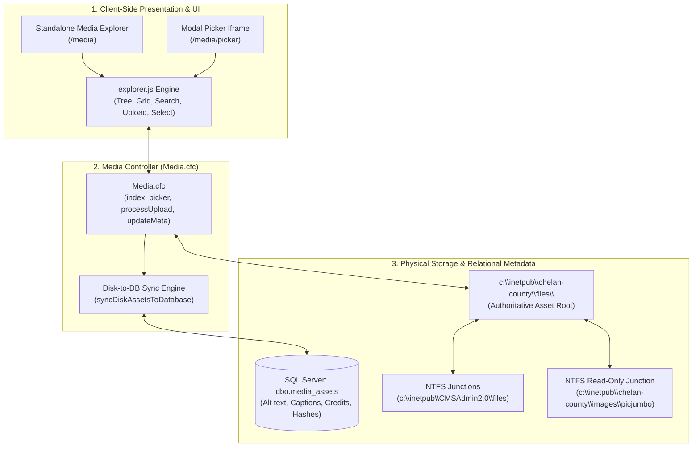
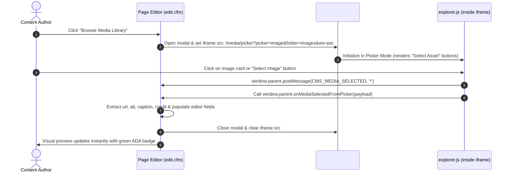

# Series 004: Media Library & Workspace File Explorer
**Location:** `.doclib/004_MEDIA_LIBRARY_AND_FILE_EXPLORER.md`  
**Parent Index:** [000_SERIES_INDEX.md](file:///c:/inetpub/CMSAdmin2.0/.doclib/000_SERIES_INDEX.md)  
**Classification:** Digital Asset Management (DAM) & Storage Subsystem  
**Version Parity:** v2.1.325+  
**Target Audience:** County Authors, Web Administrators, Storage Architects, Full-Stack Engineers

---

## 1. Executive Summary & Storage Topology

The **Media Library & Workspace File Explorer** ([`Media.cfc`](file:///c:/inetpub/CMSAdmin2.0/app/controllers/Media.cfc), [`javascripts/filexplorer/explorer.js`](file:///c:/inetpub/CMSAdmin2.0/javascripts/filexplorer/explorer.js), and [`app/views/media/`](file:///c:/inetpub/CMSAdmin2.0/app/views/media/)) is Chelan County's centralized digital asset repository. It governs file browsing, high-resolution photo optimization, public document publishing (PDFs, resolutions, notices), multi-tenant department isolation, and modal picker integration for the Page and Article editors.



### Authoritative Physical Storage Architecture
All county digital assets are permanently stored on the local file server at:
```
c:\inetpub\chelan-county\files\
├── pio\
│   ├── images\                  # Department photographs, press photos
│   └── documents\               # Official releases, ordinances, notices
├── assessor\
│   ├── images\
│   └── documents\
├── sheriff\
│   ├── images\
│   └── documents\
├── public-works\
│   ├── images\
│   └── documents\
└── ...
```

### Assets Domain (`assets.chelancounty.com`) & NTFS Directory Junctions
All image `src` attributes and document `href` links across CMSAdmin 2.0, `dbo.media_assets`, `dbo.pages`, `dbo.articles`, and `dbo.rfp_solicitations` reference the workspace's configured **`assets_domain`** (stored in `dbo.cms_workspaces.assets_domain`, defaulting to **`assets.chelancounty.com`**):
- **Canonical Image & Document URL Format:** `https://assets.chelancounty.com/[workspace]/[folder]/[filename]`
- **Assets Path Display Format:** `assets.chelancounty.com\[workspace]\[folder]`

To allow IIS to serve media files directly while ensuring absolute synchronization with county network paths, CMSAdmin 2.0 leverages Windows NTFS Directory Junctions:
1. **CMSAdmin Files Junction:**
   `c:\inetpub\CMSAdmin2.0\files\` $\rightarrow$ `c:\inetpub\chelan-county\files\`  
   Enables web browsers to fetch assets via `https://assets.chelancounty.com/pio/images/press-conference.jpg` (with automatic local `/files/` fallback during local development).
2. **Shared County Photo Library Junction (`shared images`):**
   `c:\inetpub\chelan-county\files\shared images\` $\rightarrow$ `c:\inetpub\chelan-county\images\picjumbo`  
   `c:\inetpub\CMSAdmin2.0\images\picjumbo\` $\rightarrow$ `c:\inetpub\chelan-county\images\picjumbo`  
   - Resides **at the root level** outside any department folder.
   - Rendered as an immutable, shared public asset library across all departments.
   - Permanently marked **Read-Only** (uploads, renames, and deletions are strictly disabled).

---

## 2. File Topology & Component Responsibilities

| Component / Layer | Physical File Path | Purpose & Responsibilities |
| :--- | :--- | :--- |
| **Controller** | [`app/controllers/Media.cfc`](file:///c:/inetpub/CMSAdmin2.0/app/controllers/Media.cfc) | Directory navigation, security path canonicalization, file uploads, asset synchronization, and metadata persistence. |
| **Explorer Engine** | [`javascripts/filexplorer/explorer.js`](file:///c:/inetpub/CMSAdmin2.0/javascripts/filexplorer/explorer.js) | Standalone client-side application: folder tree navigation, grid/list view toggling, live file search, drag-and-drop upload zone, and picker selection emitter. |
| **Standalone View** | [`app/views/media/index.cfm`](file:///c:/inetpub/CMSAdmin2.0/app/views/media/index.cfm) | Full-screen media management interface with folder tree, asset details sidebar, and metadata editing forms. |
| **Picker View** | [`app/views/media/picker.cfm`](file:///c:/inetpub/CMSAdmin2.0/app/views/media/picker.cfm) | Lightweight modal iframe interface optimized for fast file selection inside the Page and Article editors. |
| **Routes** | [`config/routes.cfm`](file:///c:/inetpub/CMSAdmin2.0/config/routes.cfm) | Maps `/media`, `/media/picker`, `/media/upload`, and `/media/metadata`. |

---

## 3. Relational Database Schema: `dbo.media_assets`

To enable instantaneous searching, rich media attribution, and ADA compliance tracking across hundreds of gigabytes of files, `Media.cfc` pairs physical disk storage with a relational metadata index:

```sql
SET ANSI_NULLS ON;
SET QUOTED_IDENTIFIER ON;

CREATE TABLE dbo.media_assets (
    [id]                INT IDENTITY(1,1) NOT NULL PRIMARY KEY,
    [site_id]           NVARCHAR(50) NOT NULL,
    [folder]            NVARCHAR(300) NOT NULL,
    [filename]          NVARCHAR(255) NOT NULL,
    [file_path]         NVARCHAR(500) NOT NULL,
    [web_url]           NVARCHAR(500) NOT NULL,
    [file_size]         BIGINT NOT NULL DEFAULT 0,
    [file_ext]          NVARCHAR(50) NOT NULL,
    [mime_type]         NVARCHAR(100) NULL,
    [file_hash]         NVARCHAR(64) NULL, -- SHA-256 integrity hash
    [title]             NVARCHAR(255) NULL,
    [alt_text]          NVARCHAR(1000) NULL,
    [caption]           NVARCHAR(1000) NULL,
    [credit]            NVARCHAR(255) NULL,
    [ocr_text]          NVARCHAR(2000) NULL, -- Extracted WinRT OCR / SVG text
    [is_image]          BIT NOT NULL DEFAULT 0,
    [width]             INT NULL,
    [height]            INT NULL,
    [is_wcag_compliant] BIT NOT NULL DEFAULT 1,
    [tags]              NVARCHAR(500) NULL,
    [created_by]        NVARCHAR(100) NULL,
    [updated_by]        NVARCHAR(100) NULL,
    [created_at]        DATETIME2(0) NOT NULL DEFAULT (SYSDATETIME()),
    [updated_at]        DATETIME2(0) NOT NULL DEFAULT (SYSDATETIME()),
    [deletedat]         DATETIME2(0) NULL
);

CREATE NONCLUSTERED INDEX [IX_media_assets_site_folder] 
ON [dbo].[media_assets] ([site_id], [folder])
INCLUDE ([filename], [web_url], [alt_text], [title])
WHERE [deletedat] IS NULL;
```

---

## 4. Modal Picker Architecture & Inter-Window Communication

When authors select featured cover photos or rich text assets in the Page or Article editors, the media system operates in **Picker Mode**.



### The PostMessage Payload Contract
When an asset is selected, `explorer.js` emits a structured payload:

```javascript
{
  "type": "CMS_MEDIA_SELECTED",
  "url": "https://assets.chelancounty.com/pio/images/2026-commissioners-hearing.jpg",
  "alt": "Board of County Commissioners reviewing public safety resolutions",
  "title": "2026 Commissioners Public Hearing",
  "caption": "Commissioners listen to public testimony regarding the annual budget.",
  "credit": "Chelan County PIO Office",
  "data": {
    "webUrl": "https://assets.chelancounty.com/pio/images/2026-commissioners-hearing.jpg",
    "name": "2026-commissioners-hearing.jpg",
    "size": 348120,
    "extension": "jpg",
    "width": 1920,
    "height": 1080
  }
}
```

---

## 5. Security & Isolation Controls

### 1. Absolute Path Traversal Protection
All file system operations in `Media.cfc` strictly validate requested relative paths against the canonical workspace directory to prevent directory traversal attacks:
```cfm
local.canonicalPath = GetCanonicalPath(local.requestedDirectory);
if (!FindNoCase(local.authorizedWorkspaceRoot, local.canonicalPath)) {
    renderJsonEnvelope(false, "Access Denied: Path outside authorized workspace root.", {}, 403);
    return;
}
```

### 2. File Extension Whitelisting
To prevent arbitrary code execution, uploaded files are checked against strict MIME and extension allowlists:
- **Approved Images:** `.jpg`, `.jpeg`, `.png`, `.gif`, `.webp`, `.svg`.
- **Approved Documents:** `.pdf`, `.docx`, `.xlsx`, `.pptx`, `.txt`, `.csv`.
- **Strictly Blocked Executables:** `.cfm`, `.cfc`, `.jsp`, `.asp`, `.aspx`, `.exe`, `.bat`, `.cmd`, `.ps1`, `.vbs`, `.sh`, `.php`.

### 3. Read-Only Enforcement for Shared Assets
The `shared images` directory (`c:\inetpub\chelan-county\images\picjumbo`) is system-enforced read-only:
- Upload buttons are hidden.
- Rename and delete options are disabled.
- Controller endpoints reject any mutation requests targeting `folder = 'shared images'` with HTTP 403.

---

## 6. Controller Methods Reference (`Media.cfc`)

| Method Name | Route | HTTP | Description |
| :--- | :--- | :---: | :--- |
| `index()` | `/media` | `GET` | Renders the full standalone File Explorer interface with folder tree and asset inspector. |
| `picker()` | `/media/picker` | `GET` | Lightweight picker interface for embed modals inside Page and Article editors. |
| `processUpload()` | `/media/upload` | `POST` | Handles single or multi-file uploads with extension validation, auto-renaming, and thumbnail creation. |
| `updateMeta()` | `/media/metadata` | `POST` | Persists title, alt text, caption, and credit attributes to `dbo.media_assets`. |
| `deleteFile()` | `/media/delete` | `POST` | Soft-deletes database record and moves physical file to `.trash` archive. |
| `renameFile()` | `/media/rename` | `POST` | Safely renames files on disk and updates relational URL references. |
| `crawlFolder()` | `/api/Files.cfc?method=crawlFolder` | `POST` | Recursively crawls a target folder, runs WinRT OCR & visual content detection, generates `.thumbs/` previews, and upserts WCAG 1.1.1 compliant records into `dbo.media_assets`. |
| `analyzeUploadOcr()` | `/api/Files.cfc?method=analyzeUploadOcr` | `POST` | Runs sub-second pre-flight OCR & visual analysis on a file selected in the upload dropzone to auto-fill Display Title, WCAG Alt Text, Caption, Credit, and Tags before upload. |

---

## 7. OCR Content Detection, Folder Auto-Compliance Crawler & On-Upload Pre-Fill

CMSAdmin 2.0 includes a built-in **OCR Content Detection & Folder Auto-Compliance Engine** ([`scripts/crawl-folder-ocr.ps1`](file:///c:/inetpub/CMSAdmin2.0/scripts/crawl-folder-ocr.ps1) and [`api/Files.cfc`](file:///c:/inetpub/CMSAdmin2.0/api/Files.cfc)) that ensures every image on disk or selected for upload receives accurate, screen-reader-ready **WCAG 2.1 AA (`1.1.1 Non-text Content`)** metadata.

### 1. 5-Stage Image Analysis Pipeline
1. **Windows Native WinRT OCR (`Windows.Media.Ocr.OcrEngine`):** Extracts embedded text from `.jpg`, `.jpeg`, `.png`, `.bmp`, and `.gif` images (flyers, posters, vehicle license plates, signs, screenshots) and strips OCR punctuation artifacts.
2. **Visual Pixel Composition (`System.Drawing.Bitmap`):** Measures dimensions (`width` × `height`), calculates orientation (`panoramic banner`, `landscape`, `portrait`, `square`), detects alpha transparency, and samples dominant color tones (`lush green botanical foliage`, `sky and water blue tones`, `warm sunlit earth tones`, `dramatic dark background`, `neutral grayscale tones`, etc.).
3. **SVG XML & Photographer Credit Extraction:** Parses `<title>` / `aria-label` from `.svg` files and extracts photographer/subject credits from `~` filename suffixes (e.g., `Wedding5~Pamela%20Grillo%20Photography.jpg` -> Credit: `Pamela Grillo Photography`).
4. **SHA-256 Hash De-Duplication & Title Recovery:** Matches hash-named files against human-named files and OCR text.
5. **Server-Side `.thumbs/` Generation & Database Upsert:** Creates `360x360` max-dimension thumbnails inside `<folder>\.thumbs\<filename>` and upserts all metadata (`alt_text`, `ocr_text`, `title`, `caption`, `credit`, `tags`, `is_wcag_compliant = 1`) into `dbo.media_assets`.

### 2. On-Upload Pre-Flight OCR Auto-Prefill
Whenever a user selects or drops an image into:
- **Media Library Quick Upload** (`/media`)
- **Media Picker Quick Upload** (`/media/picker`)
- **Full Upload Studio** (`/media/upload`)

The browser immediately posts the file to `/api/Files.cfc?method=analyzeUploadOcr&returnformat=json` (~0.6–0.9s) and automatically pre-fills **Alternative Text (WCAG 1.1.1)**, **Display Title**, **Caption**, **Photographer Credit**, and **Tags**, displaying a live badge with any detected OCR text and visual dimensions/palette.

### 3. Batch Folder Crawl (UI & PowerShell CLI)
- **From Media Library UI (`/media`):** Click **OCR Crawl & Auto-Comply Folder** in the header (or **OCR Crawl & Make Compliant** in the right-hand folder details inspector), enter/select the folder path, and click **Start OCR Crawl & Make Compliant**.
- **From PowerShell CLI:**
  ```powershell
  cd C:\inetpub\CMSAdmin2.0
  .\scripts\crawl-folder-ocr.ps1 -FolderPath "C:\inetpub\chelan-county\files\ohme-gardens"
  ```

---

## 8. Storage Maintenance & Junction Recovery

If NTFS directory junctions are inadvertently broken during server migrations or disk reorganizations, administrators can reconstruct them via elevated PowerShell:

```powershell
# Recreate CMSAdmin files junction
New-Item -ItemType Junction -Path "C:\inetpub\CMSAdmin2.0\files" -Target "C:\inetpub\chelan-county\files"

# Recreate shared photo library junction
New-Item -ItemType Junction -Path "C:\inetpub\chelan-county\files\shared images" -Target "C:\inetpub\chelan-county\images\picjumbo"
New-Item -ItemType Junction -Path "C:\inetpub\CMSAdmin2.0\images\picjumbo" -Target "C:\inetpub\chelan-county\images\picjumbo"
```
