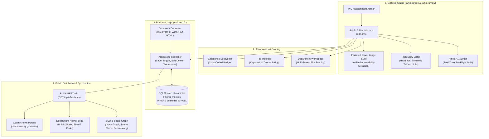
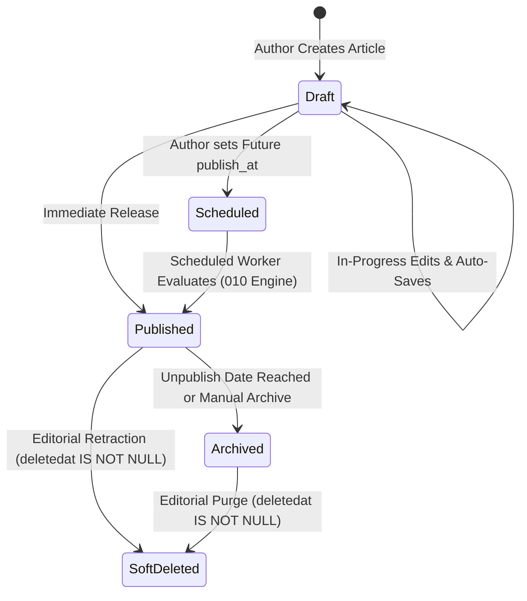

# Series 005: Articles & Public Information Module
**Location:** `.doclib/005_ARTICLES_AND_PUBLIC_INFORMATION.md`  
**Parent Index:** [000_SERIES_INDEX.md](file:///c:/inetpub/CMSAdmin2.0/.doclib/000_SERIES_INDEX.md)  
**Classification:** Core News, Media Communications & Public Information Subsystem  
**Version Parity:** v2.1.1+  
**Target Audience:** Public Information Officers (PIO), Department Editors, Media Staff, Full-Stack Engineers

---

## 1. Executive Summary & Operational Scope

The **Articles & Public Information Subsystem** ([`Articles.cfc`](file:///c:/inetpub/CMSAdmin2.0/app/controllers/Articles.cfc) and [`app/views/articles/`](file:///c:/inetpub/CMSAdmin2.0/app/views/articles/)) is Chelan County's primary journalistic publishing platform. It powers official press announcements, department news releases, public hearings, project updates, and emergency community briefings across all county web properties.



### Core Editorial Principles
1. **Multi-Tenant Workspace Scoping:** Articles are authored under specific department workspaces (e.g., `sheriff`, `public-works`, `natural-resources`) or marked as county-wide `global` announcements.
2. **Statutory Integrity & Archiving:** Conforming to RCW 42.56, news posts are **never hard-deleted**. Retracted or archived stories are soft-deleted (`deletedat IS NULL`), preserving historical audit records.
3. **Rigorous Accessibility (WCAG 2.1 AA):** All featured images must pass automated accessibility pre-flight verification before publishing live.
4. **Structured Data for Search & AI:** Automated generation of `schema.org/NewsArticle` JSON-LD metadata for search engine indexing and public news syndication.

---

## 2. File Topology & System Architecture

| Component / Layer | Physical File Path | Purpose & Responsibilities |
| :--- | :--- | :--- |
| **Controller** | [`app/controllers/Articles.cfc`](file:///c:/inetpub/CMSAdmin2.0/app/controllers/Articles.cfc) | Governs article CRUD, 1-click status toggling, categories, tag associations, public REST API, and document conversion. |
| **Directory View** | [`app/views/articles/index.cfm`](file:///c:/inetpub/CMSAdmin2.0/app/views/articles/index.cfm) | Newsroom dashboard: KPI cards (Total, Published, Scheduled, Draft), filterable directory table, search, and batch actions. |
| **Editor View** | [`app/views/articles/edit.cfm`](file:///c:/inetpub/CMSAdmin2.0/app/views/articles/edit.cfm) | Primary authoring interface: Headline, Slug auto-generator, Cover Image Suite, CKEditor rich text, SEO panel, and Linter drawer. |
| **Categories View** | [`app/views/articles/categories.cfm`](file:///c:/inetpub/CMSAdmin2.0/app/views/articles/categories.cfm) | Category taxonomy manager with color-picker badges, slug generation, and article count aggregations. |
| **Tags View** | [`app/views/articles/tags.cfm`](file:///c:/inetpub/CMSAdmin2.0/app/views/articles/tags.cfm) | Tag repository manager for metadata keyword indexing. |
| **Accessibility Linter** | [`javascripts/linter/articleA11yLinter.js`](file:///c:/inetpub/CMSAdmin2.0/javascripts/linter/articleA11yLinter.js) | Real-time WCAG 2.1 AA pre-flight auditor scanning cover imagery, body photos, heading hierarchy, links, and tables. |
| **Media Picker** | [`javascripts/filexplorer/explorer.js`](file:///c:/inetpub/CMSAdmin2.0/javascripts/filexplorer/explorer.js) | Integrated media selector for browsing, uploading, and inserting high-resolution cover photos. |
| **Routes** | [`config/routes.cfm`](file:///c:/inetpub/CMSAdmin2.0/config/routes.cfm) | Maps `/articles`, `/articles/edit`, `/articles/save`, `/articles/categories`, and `/api/v1/articles`. |

---

## 3. Relational Database Schema & Data Dictionary

The subsystem is backed by three relational tables in the `ChelanCountyWebsite` Microsoft SQL Server database: `dbo.articles`, `dbo.article_categories`, and `dbo.article_tags`.

### 1. Primary Table: `dbo.articles`

```sql
SET ANSI_NULLS ON;
SET QUOTED_IDENTIFIER ON;

CREATE TABLE [dbo].[articles] (
    [id]                          INT IDENTITY(1,1) NOT NULL,
    [title]                       NVARCHAR(255) NOT NULL,
    [slug]                        NVARCHAR(255) NOT NULL,
    [summary]                     NVARCHAR(1000) NULL,
    [content_html]                NVARCHAR(MAX) NOT NULL,
    [category_id]                 INT NULL,
    [tags]                        NVARCHAR(500) NULL,
    -- Featured Cover Image Suite
    [featured_image]              NVARCHAR(1000) NULL,
    [featured_image_alt]          NVARCHAR(500) NULL,
    [featured_image_caption]      NVARCHAR(1000) NULL,
    [featured_image_description]  NVARCHAR(2000) NULL,
    [featured_image_credit]       NVARCHAR(255) NULL,
    [featured_image_decorative]   BIT NOT NULL CONSTRAINT [DF_articles_decorative] DEFAULT (0),
    -- Editorial & Author Details
    [author_name]                 NVARCHAR(255) NOT NULL,
    [author_title]                NVARCHAR(255) NULL,
    [status]                      NVARCHAR(50) NOT NULL CONSTRAINT [DF_articles_status] DEFAULT ('published'), -- 'draft', 'scheduled', 'published', 'archived'
    [siteid]                      NVARCHAR(100) NOT NULL CONSTRAINT [DF_articles_siteid] DEFAULT ('global'),
    -- Publishing Timeline
    [published_at]                DATETIME2(7) NOT NULL CONSTRAINT [DF_articles_published_at] DEFAULT (SYSUTCDATETIME()),
    [publish_at]                  DATETIME2(7) NULL,
    [unpublish_at]                DATETIME2(7) NULL,
    -- SEO & Social Graph
    [meta_title]                  NVARCHAR(255) NULL,
    [meta_description]            NVARCHAR(500) NULL,
    -- Audit Tracking
    [created_by]                  NVARCHAR(255) NULL,
    [modified_by]                 NVARCHAR(255) NULL,
    [createdat]                   DATETIME2(7) NOT NULL CONSTRAINT [DF_articles_createdat] DEFAULT (SYSUTCDATETIME()),
    [updatedat]                   DATETIME2(7) NOT NULL CONSTRAINT [DF_articles_updatedat] DEFAULT (SYSUTCDATETIME()),
    [deletedat]                   DATETIME2(7) NULL,
    CONSTRAINT [PK_articles] PRIMARY KEY CLUSTERED ([id] ASC)
);

CREATE NONCLUSTERED INDEX [IX_articles_site_status] 
ON [dbo].[articles] ([siteid], [status])
INCLUDE ([title], [slug], [published_at], [category_id])
WHERE [deletedat] IS NULL;

CREATE NONCLUSTERED INDEX [IX_articles_published_at] 
ON [dbo].[articles] ([published_at] DESC)
WHERE [deletedat] IS NULL AND [status] = 'published';
```

### 2. Category Taxonomy: `dbo.article_categories`

```sql
CREATE TABLE [dbo].[article_categories] (
    [id]          INT IDENTITY(1,1) NOT NULL,
    [name]        NVARCHAR(100) NOT NULL,
    [slug]        NVARCHAR(100) NOT NULL,
    [description] NVARCHAR(500) NULL,
    [badge_color] NVARCHAR(50) NOT NULL CONSTRAINT [DF_art_cats_badge] DEFAULT ('#0284c7'),
    [sort_order]  INT NOT NULL CONSTRAINT [DF_art_cats_sort] DEFAULT (0),
    [createdat]   DATETIME2(7) NOT NULL DEFAULT (SYSUTCDATETIME()),
    [updatedat]   DATETIME2(7) NOT NULL DEFAULT (SYSUTCDATETIME()),
    [deletedat]   DATETIME2(7) NULL,
    CONSTRAINT [PK_article_categories] PRIMARY KEY CLUSTERED ([id] ASC)
);
```

> [!IMPORTANT]
> **Mandatory SQL Server Filtered Index Invariant:**  
> Because `IX_articles_site_status` and `IX_articles_published_at` use filtered predicates (`WHERE deletedat IS NULL`), every query executing on `dbo.articles` **MUST** be prepended with:
> ```sql
> SET ANSI_NULLS ON;
> SET QUOTED_IDENTIFIER ON;
> ```

---

## 4. Featured Cover Image Accessibility Suite

The Featured Cover Image Suite in `edit.cfm` ensures 100% compliance with Section 508 and WCAG 2.1 Level AA:

```
+------------------------------------------------------------------------------------------------+
| Featured Cover Photo Panel                                                                     |
+------------------------------------------------------------------------------------------------+
| [ Image Preview Canvas ]                                                                       |
| [ Select Image from Media Library ]  [ Clear Photo ]                                           |
+------------------------------------------------------------------------------------------------+
| Photo Credit / Source:     [ e.g. Chelan County Sheriff's Office / Deputy Jane Doe            ] |
| Alternative Text (ADA) *:  [ Real-time character counter: 64/150 rec. (Max 500)                ] |
|                            [ Suggest from Headline Button ]                                    |
| Story Caption:             [ Visible caption displayed publicly beneath the article photo      ] |
| Extended Description:      [ Transcribed detail for complex charts, maps, or infographics      ] |
| [x] Mark as Decorative Only (Exempt from Alt Text under WCAG 2.1 Technique H67)               |
+------------------------------------------------------------------------------------------------+
```

### The 6 Metadata Attributes

| Attribute Field | Schema Column | Purpose & Accessibility Rule |
| :--- | :--- | :--- |
| **Image URL** | `featured_image` | Absolute or relative URL to the high-resolution asset in the Media Repository. |
| **Photo Credit** | `featured_image_credit` | Attribution for county photographers, news outlets, or partnering agencies. |
| **Alternative Text** | `featured_image_alt` | Required screen-reader description under 150 characters. Audited against generic words (`"photo"`, `"image"`) and raw filenames (`.jpg`). |
| **Story Caption** | `featured_image_caption`| Public journalistic caption rendered directly beneath the image on citizen-facing views. |
| **Extended Description**| `featured_image_description`| 2,000-character transcription field for complex visual data (e.g. wildfire evacuation maps or flood hydrographs) per WCAG 1.1.1. |
| **Decorative Toggle** | `featured_image_decorative` | Implements WCAG Technique H67. When enabled, assistive technologies skip the asset (`alt=""`, `role="presentation"`), waiving mandatory alt text requirements. |

---

## 5. In-Editor Automated ADA WCAG Pre-Flight Linter

The Article Editor incorporates `window.ArticleA11yLinter`:

1. **Real-Time Scanning Engine:**
   - Evaluates cover imagery, inline rich-text images, heading tag hierarchy (`<h1>` through `<h6>`), link text descriptiveness, data tables, and text readability.
2. **Category Chips:**
   - `Cover` (Cover photo alt text & decorative state)
   - `Images` (Body images with valid alt text)
   - `Headings` (Ensures no skipped heading levels, e.g. `<h2>` directly to `<h4>`)
   - `Links` (Flags generic `"click here"` or `"read more"` links lacking accessible context)
   - `Tables` (Ensures `<th>` headers with `scope="col"` or `scope="row"`)
   - `Readability` (Flesch-Kincaid grade level scoring for plain language compliance)
3. **Pre-Publish Quality Gate:**
   - If critical violations exist when the author clicks **Publish Live**, the editor displays a modal alert requiring confirmation or remediation before going live.

---

## 6. Article Publication Lifecycle & Scheduled Publishing



1. **Draft (`status = 'draft'`):** Work-in-progress story visible only to authenticated editors within the department workspace.
2. **Scheduled (`status = 'scheduled'`):** Validated article with a future `publish_at` timestamp. Automatically transitioned to `published` by the **Series 010 Scheduled Publishing Worker**.
3. **Published (`status = 'published'`):** Live on the public website, accessible via the public REST API, and broadcasted to RSS/social syndication feeds.
4. **Archived (`status = 'archived'`):** Retained in historical search archives but excluded from homepage hero feeds.
5. **Soft-Deleted (`deletedat IS NOT NULL`):** Permanently hidden from public views but preserved for legal compliance under RCW 42.56.

---

## 7. Controller Actions Reference (`Articles.cfc`)

| Method Name | HTTP / Route | Access Gate | Description |
| :--- | :--- | :--- | :--- |
| `index()` | `GET /articles` | Authenticated | Renders the articles dashboard with KPI statistics, search, category filters, and directory table. |
| `new()` | `GET /articles/new` | Authenticated | Initializes a blank article record, loads categories and department workspaces. |
| `edit()` | `GET /articles/edit` | Authenticated | Loads article record by `?id=N` for editing, including categories, tags, and cover image suite. |
| `save()` | `POST /articles/save` | Authenticated + CSRF | Inserts or updates an article. Automatically generates unique URL slugs and validates required fields. |
| `delete()` | `POST /articles/delete` | Authenticated + CSRF | Soft-deletes an article by populating `deletedat = SYSUTCDATETIME()`. |
| `toggleStatus()` | `POST /articles/toggle-status`| Authenticated + CSRF | Rapid 1-click status switch (`published` $\leftrightarrow$ `draft`). |
| `categories()` | `GET /articles/categories` | Authenticated | Category taxonomy manager interface. |
| `saveCategory()` | `POST /articles/category/save`| Authenticated + CSRF | Creates or updates an article category with color badge styling. |
| `deleteCategory()`| `POST /articles/category/delete`| Authenticated + CSRF | Soft-deletes a category. |
| `tags()` | `GET /articles/tags` | Authenticated | Tag repository manager interface. |
| `saveTag()` | `POST /articles/tag/save` | Authenticated + CSRF | Creates or updates a tag. |
| `deleteTag()` | `POST /articles/tag/delete` | Authenticated + CSRF | Soft-deletes a tag. |
| `api()` | `GET /api/v1/articles` | **Public (CORS)** | High-speed JSON API delivering published articles to external portals and mobile feeds. |
| `convertDocument()`| `POST /articles/convert-document`| Authenticated + CSRF | Pure ColdFusion Word/PDF to WCAG AA HTML conversion endpoint. |

---

## 8. Public REST API Specification (`GET /api/v1/articles`)

Delivers published articles to citizen-facing websites (`chelancounty.gov/news`), department portals, and regional aggregators.

### Request Query Parameters

| Parameter | Type | Required | Default | Description |
| :--- | :---: | :---: | :---: | :--- |
| `site` | `string` | No | `'global'` | Filter by workspace slug (e.g. `sheriff`, `public-works`, `natural-resources`). |
| `category` | `string / int` | No | `all` | Filter by category ID or category slug. |
| `tag` | `string` | No | `all` | Filter by tag keyword. |
| `limit` | `int` | No | `20` | Max records to return (1–100). |
| `page` | `int` | No | `1` | Pagination offset page number. |
| `q` | `string` | No | `""` | Keyword search query against headline and body content. |

### Sample Response JSON

```json
{
  "success": true,
  "count": 1,
  "total": 48,
  "page": 1,
  "limit": 20,
  "articles": [
    {
      "id": 108,
      "title": "Chelan County Commissioners Adopt 2027 Comprehensive Wildfire Protection Plan",
      "slug": "commissioners-adopt-2027-wildfire-plan",
      "summary": "The Board of County Commissioners unanimously approved an updated Wildfire Protection Plan prioritizing forest thinning and community defensible space.",
      "category": {
        "id": 4,
        "name": "Public Safety",
        "slug": "public-safety",
        "badge_color": "#b91c1c"
      },
      "tags": ["Wildfire", "Commissioners", "Public Safety", "Natural Resources"],
      "featured_image": {
        "url": "/media/news/wildfire-plan-hearing.jpg",
        "alt": "Commissioners examining a regional wildfire risk map during a public hearing",
        "caption": "Commissioners review defensible space zones during the public hearing.",
        "credit": "Chelan County PIO Office",
        "decorative": false
      },
      "author": {
        "name": "Jill FitzSimmons",
        "title": "Public Information Officer"
      },
      "siteid": "global",
      "published_at": "2026-10-18T16:00:00Z"
    }
  ]
}
```

---

## 9. Search Engine Optimization (SEO) & Social Graph

Every article automatically emits structured Open Graph, Twitter Cards, and schema.org metadata:

```html
<!-- Open Graph Protocol -->
<meta property="og:type" content="article">
<meta property="og:title" content="Chelan County Commissioners Adopt 2027 Comprehensive Wildfire Protection Plan">
<meta property="og:description" content="The Board of County Commissioners unanimously approved an updated Wildfire Protection Plan...">
<meta property="og:image" content="https://www.chelancounty.gov/media/news/wildfire-plan-hearing.jpg">
<meta property="og:site_name" content="Chelan County, Washington">
<meta property="article:published_time" content="2026-10-18T16:00:00Z">
<meta property="article:section" content="Public Safety">

<!-- Schema.org / Google NewsArticle JSON-LD -->
<script type="application/ld+json">
{
  "@context": "https://schema.org",
  "@type": "NewsArticle",
  "headline": "Chelan County Commissioners Adopt 2027 Comprehensive Wildfire Protection Plan",
  "image": ["https://www.chelancounty.gov/media/news/wildfire-plan-hearing.jpg"],
  "datePublished": "2026-10-18T16:00:00Z",
  "author": [{
    "@type": "Person",
    "name": "Jill FitzSimmons",
    "jobTitle": "Public Information Officer"
  }],
  "publisher": {
    "@type": "GovernmentOrganization",
    "name": "Chelan County",
    "url": "https://www.chelancounty.gov"
  }
}
</script>
```

---

## 10. Operational Standards & Verification

1. **Zero Native Dialogs Policy:** All confirmation prompts (deletion, status toggles) strictly utilize `window.adminConfirm()` and `window.showToast()`.
2. **Filtered Indexing Directives:** All SQL queries touching `dbo.articles` must execute with `SET ANSI_NULLS ON; SET QUOTED_IDENTIFIER ON;`.
3. **No External CDNs:** All icons, rich text editor assets, and CSS libraries are hosted locally.
