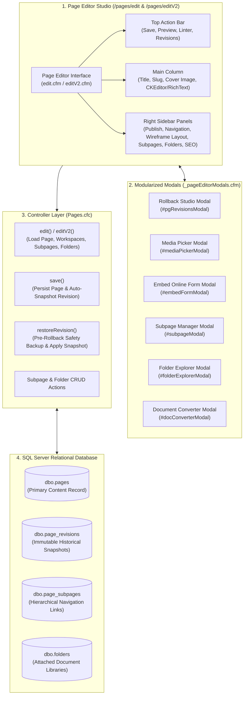
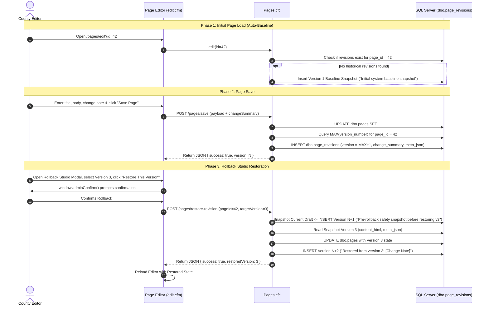

# Series 006: Pages & Revision History Rollback Studio
**Location:** `.doclib/006_PAGES_AND_REVISION_HISTORY_STUDIO.md`  
**Parent Index:** [000_SERIES_INDEX.md](file:///c:/inetpub/CMSAdmin2.0/.doclib/000_SERIES_INDEX.md)  
**Classification:** Core CMS Authoring Engine & Legal Audit Trail Subsystem  
**Version Parity:** v2.1.1+  
**Target Audience:** County Web Authors, Department Editors, PIO Staff, Full-Stack Engineers

---

## 1. Executive Summary & Statutory Mandate

The **Pages & Revision History Rollback Studio** is the central editorial engine of Chelan County CMSAdmin 2.0 ([`Pages.cfc`](file:///c:/inetpub/CMSAdmin2.0/app/controllers/Pages.cfc) and [`edit.cfm`](file:///c:/inetpub/CMSAdmin2.0/app/views/pages/edit.cfm)). It governs the creation, layout configuration, media integration, accessibility linting, and statutory lifecycle management for thousands of official county web pages across all department workspaces (Commissioners, Sheriff, Public Works, Community Development, Natural Resources, Superior Court, etc.).



### Statutory Compliance: RCW 42.56 (Washington State Public Records Act)
Under Washington State law (RCW 42.56), local government entities must preserve immutable audit trails of public digital publications and administrative revisions:
1. **Zero Data Loss:** When a page is modified or restored, no historical version is ever overwritten.
2. **Pre-Rollback Safety Snapshots:** Prior to executing any historical version rollback, an automated safety snapshot of the active draft is committed to ensure unintentional rollbacks can be undone immediately.
3. **Actor Attribution & Timestamps:** Every revision captures the author's full name, email, UTC timestamp, byte footprint, and human-entered change summary notes.

---

## 2. File Topology & Component Architecture

| Component / Layer | Physical File Path | Purpose & Responsibilities |
| :--- | :--- | :--- |
| **Controller** | [`app/controllers/Pages.cfc`](file:///c:/inetpub/CMSAdmin2.0/app/controllers/Pages.cfc) | Comprehensive business logic: page CRUD, snapshotting, rollbacks, subpages, folder bindings, How Do I items, CTAs, and document conversion. |
| **Primary Views** | [`app/views/pages/edit.cfm`](file:///c:/inetpub/CMSAdmin2.0/app/views/pages/edit.cfm)<br>[`app/views/pages/editV2.cfm`](file:///c:/inetpub/CMSAdmin2.0/app/views/pages/editV2.cfm) | 100% feature-synchronized page editor interfaces. Includes the modular modals and scripts partials. |
| **Listing View** | [`app/views/pages/index.cfm`](file:///c:/inetpub/CMSAdmin2.0/app/views/pages/index.cfm) | Content Manager tree directory with workspace filtering, status filters, search, and direct edit shortcuts. |
| **Modals Partial** | [`app/views/pages/_pageEditorModals.cfm`](file:///c:/inetpub/CMSAdmin2.0/app/views/pages/_pageEditorModals.cfm) | Encapsulated modal dialogs for Media Picker, Rollback Studio, Form Embedder, Subpages, Folder Explorer, and Document Converter. |
| **Scripts Partial** | [`app/views/pages/_pageEditorScripts.cfm`](file:///c:/inetpub/CMSAdmin2.0/app/views/pages/_pageEditorScripts.cfm) | Client-side engine: LCS diff engine, modal handlers, auto-slugifier, cover image previewer, linter bridge, and form validation. |
| **Accessibility Linter** | [`javascripts/linter/pageA11yLinter.js`](file:///c:/inetpub/CMSAdmin2.0/javascripts/linter/pageA11yLinter.js) | Real-time WCAG 2.1 AA pre-flight auditor checking alt text, headings, color contrast, and empty links. |
| **Media Library Picker** | [`javascripts/filexplorer/explorer.js`](file:///c:/inetpub/CMSAdmin2.0/javascripts/filexplorer/explorer.js) | Standalone file explorer supporting picker mode with inline file selection for featured cover images and rich text insertion. |
| **Routes** | [`config/routes.cfm`](file:///c:/inetpub/CMSAdmin2.0/config/routes.cfm) | Maps `/pages/edit`, `/pages/editV2`, `/pages/save`, `/pages/restore-revision`, and related sub-endpoints. |

---

## 3. Database Schema & Data Dictionary

The page authoring system centers around `dbo.pages` and its companion snapshot table `dbo.page_revisions`.

### 1. Primary Page Table: `dbo.pages` (Legacy `ContentID` Primary Key)

```sql
SET ANSI_NULLS ON;
SET QUOTED_IDENTIFIER ON;

CREATE TABLE [dbo].[pages] (
    [ContentID]          INT IDENTITY(1,1) NOT NULL,
    [PageTitle]          NVARCHAR(255) NOT NULL,
    [Slug]               NVARCHAR(255) NOT NULL,
    [SiteID]             NVARCHAR(100) NOT NULL CONSTRAINT [DF_pages_siteid] DEFAULT ('global'),
    [ParentID]           INT NULL,
    [Status]             NVARCHAR(50) NOT NULL CONSTRAINT [DF_pages_status] DEFAULT ('Active'),
    [Visibility]         NVARCHAR(50) NOT NULL CONSTRAINT [DF_pages_visibility] DEFAULT ('Published'),
    [Layout]             NVARCHAR(50) NOT NULL CONSTRAINT [DF_pages_layout] DEFAULT ('Full'), -- 'Full' (12-col) or 'Sidebar' (3/9 Right Sidebar)
    [IsMenuItem]         BIT NOT NULL CONSTRAINT [DF_pages_menuitem] DEFAULT (0),
    [MenuOrder]          INT NOT NULL CONSTRAINT [DF_pages_menuorder] DEFAULT (0),
    [Summary]            NVARCHAR(MAX) NULL,
    [ContentHtml]        NVARCHAR(MAX) NULL,
    [MetaTitle]          NVARCHAR(255) NULL,
    [MetaDesc]           NVARCHAR(500) NULL,
    [MetaKeywords]       NVARCHAR(255) NULL,
    -- Featured Cover Image Suite
    [imageAttachment]    NVARCHAR(1000) NULL,
    [imageAttribution]   NVARCHAR(255) NULL,
    [imageAlt]           NVARCHAR(500) NULL,
    [imageTitle]         NVARCHAR(255) NULL,
    [imageDescription]   NVARCHAR(MAX) NULL,
    [imageDecorative]    BIT NOT NULL CONSTRAINT [DF_pages_img_decorative] DEFAULT (0),
    -- Scheduled Publishing
    [publish_at]         DATETIME2(7) NULL,
    [unpublish_at]       DATETIME2(7) NULL,
    -- Audit Tracking
    [author]             NVARCHAR(255) NULL,
    [createdat]          DATETIME2(7) NOT NULL CONSTRAINT [DF_pages_createdat] DEFAULT (SYSUTCDATETIME()),
    [updatedat]          DATETIME2(7) NOT NULL CONSTRAINT [DF_pages_updatedat] DEFAULT (SYSUTCDATETIME()),
    [deletedat]          DATETIME2(7) NULL,
    CONSTRAINT [PK_pages] PRIMARY KEY CLUSTERED ([ContentID] ASC)
);

CREATE NONCLUSTERED INDEX [IX_pages_slug_site] 
ON [dbo].[pages] ([Slug], [SiteID]) 
WHERE [deletedat] IS NULL;
```

### 2. Immutable Revision Snapshot Table: `dbo.page_revisions`

```sql
SET ANSI_NULLS ON;
SET QUOTED_IDENTIFIER ON;

CREATE TABLE [dbo].[page_revisions] (
    [id]                 INT IDENTITY(1,1) NOT NULL,
    [page_id]            INT NOT NULL,
    [version_number]     INT NOT NULL,
    [title]              NVARCHAR(255) NOT NULL,
    [slug]               NVARCHAR(255) NOT NULL,
    [content_html]       NVARCHAR(MAX) NULL,
    [summary]            NVARCHAR(MAX) NULL,
    [layout_type]        NVARCHAR(50) NULL,
    [meta_json]          NVARCHAR(MAX) NULL, -- Complete JSON struct of SEO, cover image, and layout settings
    [change_summary]     NVARCHAR(500) NULL,
    [created_by]         NVARCHAR(255) NULL,
    [created_at]         DATETIME2(7) NOT NULL CONSTRAINT [DF_page_revisions_created] DEFAULT (SYSUTCDATETIME()),
    CONSTRAINT [PK_page_revisions] PRIMARY KEY CLUSTERED ([id] ASC),
    CONSTRAINT [FK_page_revisions_pages] FOREIGN KEY ([page_id]) 
        REFERENCES [dbo].[pages] ([ContentID]) ON DELETE CASCADE
);

CREATE NONCLUSTERED INDEX [IX_page_revisions_page_version] 
ON [dbo].[page_revisions] ([page_id], [version_number] DESC);
```

#### What Is Captured in `meta_json`?
To guarantee 100% state restoration without data loss, `meta_json` serializes:
```json
{
  "layout": "Sidebar",
  "isMenuItem": 1,
  "parent": "Board of Commissioners",
  "metaTitle": "Chelan County Commissioners Official Portal",
  "metaDesc": "Agendas, minutes, and commissioner district information.",
  "metaKeywords": "commissioners, chelan county, public meetings",
  "imageAttachment": "/media/commissioners/hearing-room-hero.jpg",
  "imageAttribution": "Chelan County PIO Office",
  "imageAlt": "Board of County Commissioners seated at the podium in the hearing room",
  "imageTitle": "Commissioners Public Hearing Room",
  "imageDescription": "View of the commissioners rostrum with microphones and digital monitors.",
  "imageDecorative": 0,
  "sidebarIds": [102, 105, 114]
}
```

---

## 4. Snapshotting & Rollback Engine Lifecycle

The snapshotting lifecycle guarantees that every save and every restoration maintains unbroken historical integrity.



---

## 5. Interactive Rollback Studio Architecture (`#pgRevisionsModal`)

The Rollback Studio UI provides an accessible comparison modal:

### 1. Left Sidebar: Chronological Version Timeline
- Dynamically populated with historical versions from `dbo.page_revisions`.
- Shows version badges (`v1`, `v2`, `v3`), relative timestamps, author identities, character/byte sizes, and revision summaries.
- Highlights the currently active draft vs historical snapshots.

### 2. Client-Side LCS Token Diff Engine
Rather than relying on heavy server-side diff libraries, the studio implements an in-memory **Longest Common Subsequence (LCS)** word-token diff engine inside `_pageEditorScripts.cfm`:
- Computes character and word-boundary tokens.
- Generates accessible addition tags: `<ins class="diff-add">new text</ins>`.
- Generates accessible deletion tags: `<del class="diff-del">removed text</del>`.
- Displays real-time visual change metrics (e.g. `+142 words added, -38 words removed`).

### 3. Four Interactive Comparison Modes
1. **Visual Diff Mode:** Renders a cohesive document preview where added text is highlighted in soft emerald green and deleted text is struck-through in soft crimson red.
2. **Side-by-Side Split View:** Two independent, synchronized scrolling panes:
   - *Left Column:* Selected historical version snapshot.
   - *Right Column:* Current working draft.
3. **Snapshot Preview Mode:** Clean, un-diffed rendered layout displaying the exact public presentation of the page at that historical timestamp.
4. **HTML Source Code Diff:** Monospace syntax-highlighted comparative view showing raw HTML tags, class modifications, and layout containers.

---

## 6. Page Editor Layout & Wireframe Architecture

The Page Editor supports two distinct structural layout wireframes:

```
Full Width Layout (12 Columns)               Sidebar Layout (3 Cols Subpages / 9 Cols Body)
+------------------------------------+       +------------+-------------------------------+
| Page Title                         |       | Subpages / | Page Title                    |
+------------------------------------+       | Navigation | +---------------------------+ |
| Full Width Content Area            |       | Menu       | | Featured Cover Image      | |
| (100% Container Span)              |       |            | +---------------------------+ |
|                                    |       | Links      | Main Editorial Content Body   |
|                                    |       | & Folder   |                               |
+------------------------------------+       +------------+-------------------------------+
```

### Visual Layout Selector Cards
In the right sidebar panel of `edit.cfm`:
- **Card 1: Full Page Layout:** Emits `<input type="radio" name="layout" value="Full">`. Content spans the full 12-column grid container.
- **Card 2: 3/9 Sidebar Layout:** Emits `<input type="radio" name="layout" value="Sidebar">`. Allocates a 3-column left navigation rail for child subpages and folder documents, with a 9-column content body.
- **Dynamic UI Reaction:** Toggling the layout radio card dynamically reveals or collapses the Subpage Manager and Folder Explorer panels.

---

## 7. Featured Cover Image Suite & WCAG 2.1 AA Compliance

Both Pages and Articles share the standardized **Featured Cover Image Suite**:

```
+------------------------------------------------------------------------------------------------+
| Featured Cover Image Panel                                                                     |
+------------------------------------------------------------------------------------------------+
| [ Image Preview Canvas ]                                                                       |
| [ Browse Media Library Button ]  [ Clear Image Button ]                                       |
+------------------------------------------------------------------------------------------------+
| Attribution / Credit:      [ e.g. Chelan County Public Works / John Doe                      ] |
| Alternative Text (ADA) *:  [ Descriptive sentence under 150 characters                       ] |
| Story Caption / Title:     [ Headline displayed beneath the image on the public page         ] |
| Extended Description:      [ Detailed transcription for complex charts, maps, or infographics] |
| [x] Mark as Decorative Only (Exempt from Alt Text under WCAG 2.1 Technique H67)               |
+------------------------------------------------------------------------------------------------+
```

### ADA WCAG 2.1 AA Pre-Flight Linter Integration (`PageA11yLinter`)
The cover image suite is continuously audited before publication:
1. **Missing Alt Text Warning:** If an image is selected but `imageAlt` is empty and `imageDecorative` is `0`, a `CRITICAL` accessibility alert is flagged.
2. **Generic Alt Text Warning:** Flags placeholder text such as `"image"`, `"photo"`, `"picture"`, or file names like `"IMG_4021.JPG"`.
3. **Character Limit Guideline:** Enforces the 150-character concise alt text limit. For complex graphics or county aerial maps, users are prompted to utilize the **Extended Description** field.
4. **Decorative State (WCAG H67):** When `imageDecorative` is checked, the Alt Text field is disabled, and the public template automatically emits an empty `alt=""` and `role="presentation"`.

---

## 8. Integrated Editor Modals & Subsystems

All modal dialogs are cleanly isolated in [`_pageEditorModals.cfm`](file:///c:/inetpub/CMSAdmin2.0/app/views/pages/_pageEditorModals.cfm):

### 1. Media Library Picker Modal (`#mediaPickerModal`)
- Loads an iframe targeting `/media/picker?workspace={siteId}`.
- Allows authors to browse existing media or upload new assets via the standard drag-and-drop uploader.
- Automatically transmits selected image URL, title, credit, and default alt text back to the parent editor via `window.postMessage`.

### 2. Embed Online Form Modal (`#embedFormModal`)
- Connects directly to the Chelan County Form Builder subsystem (`dbo.forms`).
- Filters online forms by the active department workspace.
- Injects standard CFML shortcodes into the CKEditor instance: `[form id="12" name="Public Records Request"]`.

### 3. Subpage Manager Modal (`#subpageModal`)
- Governs the parent-child relationship for department microsites.
- Authors can link existing sibling pages, adjust sequence ordering (`display_order`), or generate new child drafts directly from the modal.

### 4. Folder Explorer Modal (`#folderExplorerModal`)
- Attaches document libraries (`dbo.folders`) to the active page (e.g. County Resolutions, Hearing Dockets, RFP packages).
- Features a reactive **Green LED Status Indicator** in the editor sidebar:
  - 🟢 **Green LED:** Folder actively linked with verified document counts.
  - ⚪ **Gray LED:** No folder attached (disabled state).

### 5. Document Converter Modal (`#docConverterModal`)
- Powered by pure ColdFusion document parsing (`Pages.cfc:convertDocument`).
- Converts Microsoft Word (`.docx`) and accessible PDF files directly into clean, semantic WCAG AA compliant HTML (stripping dirty inline MSO styles, normalizing headers, and generating accessible tables).

---

## 9. Controller Method Reference (`Pages.cfc`)

| Method Name | HTTP / Route | Access Gate | Description |
| :--- | :--- | :--- | :--- |
| `index()` | `GET /pages` | Authenticated | Renders the Content Manager directory table filtered by active workspace. |
| `edit()` | `GET /pages/edit` | Authenticated | Primary editor view; loads page struct, subpages, sidebars, folders, and workspace metadata. |
| `editV2()` | `GET /pages/editV2` | Authenticated | Parity route for the next-generation editor studio. |
| `save()` | `POST /pages/save` | Authenticated + CSRF | Validates inputs, saves page record to `dbo.pages`, and commits an automated revision snapshot to `dbo.page_revisions`. |
| `restoreRevision()`| `POST /pages/restore-revision`| Authenticated + CSRF | Executes a pre-rollback safety snapshot, then applies the selected historical snapshot to the active page. |
| `snapshotRevision()`| `POST /pages/snapshot-revision`| Authenticated + CSRF | Allows manual on-demand snapshot creation with author notes without altering page publication state. |
| `saveSubpage()` | `POST /pages/subpages/save` | Authenticated + CSRF | AJAX endpoint to bind child pages to parent containers. |
| `deleteSubpage()` | `POST /pages/subpages/delete` | Authenticated + CSRF | Removes a subpage relationship without deleting the underlying page. |
| `saveFolderExplorer()`| `POST /pages/folders/save` | Authenticated + CSRF | Links a document repository folder to the page sidebar. |
| `convertDocument()`| `POST /pages/convert-document`| Authenticated + CSRF | Uploads Word/PDF documents and returns semantic HTML for editor insertion. |

---

## 10. Invariants, Accessibility & Verification

1. **Filtered Index Connection Directives:**
   Every query executing on `dbo.pages` or child tables must include:
   ```sql
   SET ANSI_NULLS ON;
   SET QUOTED_IDENTIFIER ON;
   ```
2. **Zero Native Dialogs:**
   No `alert()` or `confirm()` calls are permitted anywhere in `edit.cfm` or `_pageEditorScripts.cfm`. Confirmations for rollbacks and deletions must use:
   ```javascript
   const ok = await window.adminConfirm({
       title: 'Restore Historical Version?',
       message: 'An automatic safety snapshot of your current draft will be preserved.',
       type: 'primary',
       confirmText: 'Restore Version'
   });
   ```
3. **Parity Enforcement:**
   `app/views/pages/edit.cfm` and `app/views/pages/editV2.cfm` must remain 100% synchronized in markup and included partials.
