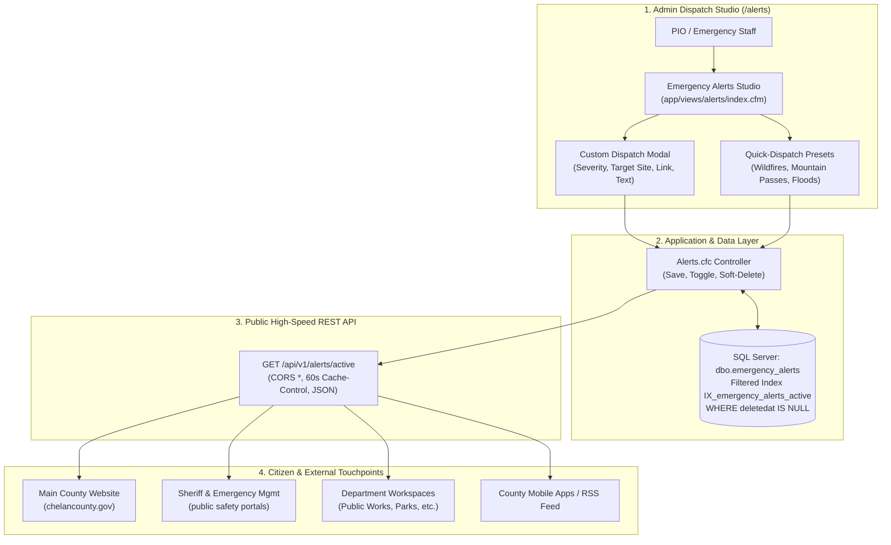
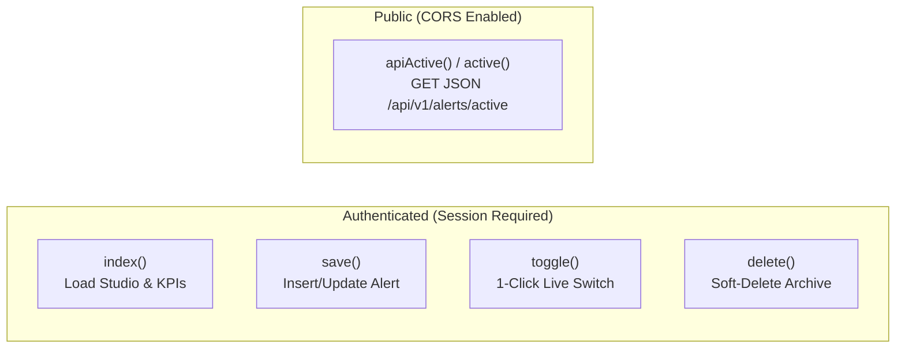

# Series 007: Emergency Alerts & Incident Dispatch System
**Location:** `.doclib/007_EMERGENCY_ALERTS_AND_INCIDENTS.md`  
**Parent Index:** [000_SERIES_INDEX.md](file:///c:/inetpub/CMSAdmin2.0/.doclib/000_SERIES_INDEX.md)  
**Classification:** Public Safety Infrastructure & Real-Time Incident Dispatch  
**Version Parity:** v2.1.1+  
**Target Audience:** PIO Staff, Emergency Management (EOC), County Administrators, Full-Stack Engineers

---

## 1. Executive Summary & Statutory Mandate

The **Emergency Alerts & Incident Dispatch Subsystem** is Chelan County's mission-critical emergency communication gateway. It empowers County Commissioners, the Sheriff's Office, the Emergency Operations Center (EOC), and Public Information Officers (PIO) to publish instantaneous, color-coded, accessible alert banners across every public-facing Chelan County digital property within seconds of an incident.



### Statutory & Public Safety Mandates
1. **Immediate Life-Safety Broadcast:** Rapid deployment of Level 1 ("GET READY"), Level 2 ("GET SET"), and Level 3 ("GO NOW") Wildfire Evacuation notices in compliance with Washington State EMD guidelines.
2. **Transportation & Infrastructure Safety:** Real-time road and mountain pass closures (US-2 Stevens Pass, US-97 Blewett Pass), avalanche warnings, and bridge washouts.
3. **Facility & Courthouse Operations:** County courthouse delays, closures, or emergency operational pivots during winter weather or public safety hazards.
4. **RCW 42.56 Compliance (Public Records Act):** Absolute record permanence. Emergency alerts are **never hard-deleted**; all past alerts, whether expired, deactivated, or retracted, maintain an immutable historical audit trail with author attribution, UTC timestamps, and soft deletion (`deletedat IS NULL`).

---

## 2. File Topology & System Architecture

| Component / Layer | Physical File Path | Purpose & Responsibilities |
| :--- | :--- | :--- |
| **Controller** | [`app/controllers/Alerts.cfc`](file:///c:/inetpub/CMSAdmin2.0/app/controllers/Alerts.cfc) | Manages authentication, RBAC authorization, CRUD operations, live status toggling, and public REST API delivery. |
| **View (Studio)** | [`app/views/alerts/index.cfm`](file:///c:/inetpub/CMSAdmin2.0/app/views/alerts/index.cfm) | Single-page Dispatch Studio UI featuring KPI counters, live banner simulator, quick-dispatch cards, broadcast history table, and accessible modals. |
| **Routes** | [`config/routes.cfm`](file:///c:/inetpub/CMSAdmin2.0/config/routes.cfm) | Defines URL endpoints for the studio, AJAX mutation handlers, and the public REST API. |
| **Database Schema** | [`config/sql/schema-emergency-alerts.sql`](file:///c:/inetpub/CMSAdmin2.0/config/sql/schema-emergency-alerts.sql) | DDL definition for `dbo.emergency_alerts`, nonclustered filtered indexes, default constraints, and baseline seed data. |
| **Base Controller** | [`app/controllers/Controller.cfc`](file:///c:/inetpub/CMSAdmin2.0/app/controllers/Controller.cfc) | Grants public unauthenticated API pass-through via `isPublicRequest()` for `/api/v1/alerts/active`. |

---

## 3. Database Schema & Data Dictionary

The subsystem is backed by `dbo.emergency_alerts` in the `ChelanCountyWebsite` Microsoft SQL Server database.

### Table Schema Definition: `dbo.emergency_alerts`

```sql
SET ANSI_NULLS ON;
SET QUOTED_IDENTIFIER ON;

CREATE TABLE [dbo].[emergency_alerts] (
    [id]             INT IDENTITY(1,1) NOT NULL,
    [title]          NVARCHAR(255) NOT NULL,
    [message]        NVARCHAR(MAX) NOT NULL,
    [severity]       NVARCHAR(50) NOT NULL CONSTRAINT [DF_emergency_alerts_severity] DEFAULT ('danger'),
    [incident_type]  NVARCHAR(50) NOT NULL CONSTRAINT [DF_emergency_alerts_type] DEFAULT ('wildfire'),
    [link_url]       NVARCHAR(1000) NULL,
    [link_text]      NVARCHAR(100) NOT NULL CONSTRAINT [DF_emergency_alerts_linktext] DEFAULT (N'View Incident Details'),
    [is_active]      BIT NOT NULL CONSTRAINT [DF_emergency_alerts_active] DEFAULT (1),
    [is_dismissible] BIT NOT NULL CONSTRAINT [DF_emergency_alerts_dismiss] DEFAULT (1),
    [siteid]         NVARCHAR(100) NOT NULL CONSTRAINT [DF_emergency_alerts_siteid] DEFAULT (N'global'),
    [starts_at]      DATETIME2(7) NULL,
    [expires_at]     DATETIME2(7) NULL,
    [created_by]     NVARCHAR(255) NULL,
    [modified_by]    NVARCHAR(255) NULL,
    [createdat]      DATETIME2(7) NOT NULL CONSTRAINT [DF_emergency_alerts_createdat] DEFAULT (SYSUTCDATETIME()),
    [updatedat]      DATETIME2(7) NOT NULL CONSTRAINT [DF_emergency_alerts_updatedat] DEFAULT (SYSUTCDATETIME()),
    [deletedat]      DATETIME2(7) NULL,
    CONSTRAINT [PK_emergency_alerts] PRIMARY KEY CLUSTERED ([id] ASC)
);
```

### Data Dictionary

| Column Name | SQL Type | Nullable | Default | Description |
| :--- | :--- | :---: | :--- | :--- |
| `id` | `INT IDENTITY(1,1)` | No | Auto (1,1) | Surrogate primary key. |
| `title` | `NVARCHAR(255)` | No | — | Bold incident headline (e.g. `LEVEL 3 EVACUATION (GO NOW): Apple Fire`). |
| `message` | `NVARCHAR(MAX)` | No | — | Full advisory body text explaining boundary lines, shelter locations, or road closures. |
| `severity` | `NVARCHAR(50)` | No | `'danger'` | Severity color tier: `'danger'` (red), `'warning'` (orange), `'info'` (blue), or `'success'` (green). |
| `incident_type` | `NVARCHAR(50)` | No | `'wildfire'` | Category classifier: `'wildfire'`, `'road_closure'`, `'weather'`, `'facility'`, or `'general'`. |
| `link_url` | `NVARCHAR(1000)`| Yes | `NULL` | Optional external or internal URL for maps, WSDOT passes, or shelter directories. |
| `link_text` | `NVARCHAR(100)` | No | `'View Incident Details'` | Accessible button label for the action link. |
| `is_active` | `BIT` | No | `1` | Broadcast switch: `1` = actively broadcasted, `0` = standby / off-air. |
| `is_dismissible`| `BIT` | No | `1` | Whether citizens can dismiss the banner on the public site via localStorage. |
| `siteid` | `NVARCHAR(100)` | No | `'global'` | Workspace scope: `'global'` (all county sites) or specific department slug (e.g., `'sheriff'`). |
| `starts_at` | `DATETIME2(7)` | Yes | `NULL` | Optional UTC schedule start time; if populated, alert will not broadcast until this time. |
| `expires_at` | `DATETIME2(7)` | Yes | `NULL` | Optional UTC expiration time; once elapsed, the alert will automatically stop broadcasting. |
| `created_by` | `NVARCHAR(255)` | Yes | `NULL` | Full name or email of the authenticated PIO/Administrator who dispatched the alert. |
| `modified_by` | `NVARCHAR(255)` | Yes | `NULL` | User identity who last toggled or edited the broadcast. |
| `createdat` | `DATETIME2(7)` | No | `SYSUTCDATETIME()`| Immutable UTC creation timestamp. |
| `updatedat` | `DATETIME2(7)` | No | `SYSUTCDATETIME()`| UTC timestamp of the last modification. |
| `deletedat` | `DATETIME2(7)` | Yes | `NULL` | Soft-delete audit timestamp. If `NOT NULL`, the record is excluded from all queries. |

### Filtered Indexing Strategy

```sql
CREATE NONCLUSTERED INDEX [IX_emergency_alerts_active] 
ON [dbo].[emergency_alerts] ([is_active], [siteid])
INCLUDE ([severity], [title], [starts_at], [expires_at])
WHERE [deletedat] IS NULL;
```

> [!IMPORTANT]
> **Mandatory SQL Server Filtered Index Connection Settings:**  
> Because `IX_emergency_alerts_active` uses a filtered predicate (`WHERE deletedat IS NULL`), every update, insert, or delete query touching `emergency_alerts` **MUST** be prepended with:
> ```sql
> SET ANSI_NULLS ON;
> SET QUOTED_IDENTIFIER ON;
> ```
> Omission of these connection directives will cause SQL Server error `Msg 1934: UPDATE failed because QUOTED_IDENTIFIER is OFF`.

---

## 4. Controller Logic & Security Matrix (`Alerts.cfc`)

The controller handles both authenticated back-office management and high-volume unauthenticated public API traffic.

### Action Breakdown



#### 1. `config()`
- Enforces `filters(through="requireLogin", except="apiActive,active")`.
- Enforces `protectsFromForgery(except="apiActive,active,save,toggle,delete")` (with AJAX CSRF validation validated via request headers).

#### 2. `index()`
- Invokes `ensureEmergencyAlertsTable()` for zero-downtime database auto-repair.
- Resolves the active user role (`admin`, `pio`, `editor`) and current workspace scoping.
- Executes an optimized query against `dbo.emergency_alerts WHERE deletedat IS NULL` ordered by `is_active DESC, id DESC`.
- Aggregates live statistical counters:
  - `stats.total`: Total historical broadcasts.
  - `stats.active`: Currently live broadcasts on public channels.
  - `stats.critical`: Count of Critical / Danger alerts.
  - `stats.warning`: Count of Warnings / Closures.
  - `stats.info`: Count of Advisory notices.
- Injects standard municipal presets via `getIncidentPresets()`.

#### 3. `save()`
- Accepts either `application/json` payload (from `fetch`) or standard form POST parameters via `readJsonOrParams()`.
- Validates required fields: `title` (max 255 chars) and `message` (required body).
- Sanitizes severity: verifies against allowlist (`danger`, `warning`, `info`, `success`), defaulting to `danger`.
- Automatically captures the current actor identity via `resolveCurrentActor()` from `session.user`.
- Performs parameterized SQL Server insert or update with `SET ANSI_NULLS ON; SET QUOTED_IDENTIFIER ON;`.
- Returns a standardized JSON response envelope: `{ "success": true, "message": "...", "id": 123 }`.

#### 4. `toggle()`
- 1-click live toggle endpoint called by the "LIVE / OFF" buttons in the studio table.
- Reads `id`, looks up current `is_active` state, flips the bit (`0` $\rightarrow$ `1` or `1` $\rightarrow$ `0`), and updates `modified_by` and `updatedat`.
- Returns `{ "success": true, "is_active": true/false }`.

#### 5. `delete()`
- Soft-deletes the record:
  ```sql
  SET ANSI_NULLS ON; SET QUOTED_IDENTIFIER ON;
  UPDATE emergency_alerts SET 
      deletedat = SYSUTCDATETIME(),
      is_active = 0,
      modified_by = :actor,
      updatedat = SYSUTCDATETIME()
  WHERE id = :id
  ```
- Ensures public site banners instantly drop the alert, while preserving historical audit records for legal discovery under RCW 42.56.

#### 6. `apiActive()` / `active()`
- High-speed public endpoint: `GET /api/v1/alerts/active` or `GET /alerts/active`.
- Sets public CORS and caching headers:
  ```http
  Access-Control-Allow-Origin: *
  Access-Control-Allow-Methods: GET, OPTIONS
  Cache-Control: public, max-age=60, s-maxage=60
  Content-Type: application/json; charset=utf-8
  ```
- Temporal & multi-tenant filter logic:
  ```sql
  WHERE deletedat IS NULL
    AND is_active = 1
    AND (starts_at IS NULL OR starts_at <= SYSUTCDATETIME())
    AND (expires_at IS NULL OR expires_at >= SYSUTCDATETIME())
    AND (siteid = 'global' OR siteid = :site)
  ORDER BY 
    CASE severity WHEN 'danger' THEN 1 WHEN 'warning' THEN 2 ELSE 3 END ASC, 
    id DESC
  ```

---

## 5. Incident Severity Tiers & Quick-Dispatch Preset Catalog

The alert system classifies incidents into four visual and psychological urgency tiers:

| Severity Code | Badge Class | Hex Brand Color | Banner Styling | Real-World Application in Chelan County |
| :--- | :--- | :--- | :--- | :--- |
| **`danger`** | `badge-danger` | `#b91c1c` (Crimson Red) | Red background, dark red accent border, pulsing icon | **Level 3 "GO NOW" Wildfire Evacuations**, catastrophic flooding, immediate threat to life, active emergency incident. |
| **`warning`** | `badge-warning` | `#c2410c` (Emergency Amber) | Amber background, burnt-orange accent border | **Level 2 "GET SET" Evacuations**, mountain pass closures (Blewett / Stevens Pass chains required), major road washouts. |
| **`info`** | `badge-info` | `#0284c7` (Public Blue) | Ocean blue background, navy accent border | **Level 1 "GET READY" Advisories**, Courthouse 2-hour winter weather delays, public hearing schedule changes. |
| **`success`** | `badge-success` | `#15803d` (All-Clear Green) | Emerald green background, dark green accent border | **All-Clear Notices**, evacuation rescissions, road/pass re-openings, facility resumption notices. |

### Built-in Standard Municipal Presets

The Dispatch Studio provides pre-packaged emergency templates for rapid, zero-latency broadcast:

```javascript
[
  {
    "id": "wildfire-level3",
    "name": "Wildfire Level 3 (GO NOW)",
    "severity": "danger",
    "incident_type": "wildfire",
    "title": "LEVEL 3 EVACUATION (GO NOW): Imminent Wildfire Hazard",
    "message": "DANGER IS IMMINENT! Evacuate immediately. Danger in your area is current or imminent. Do not delay, gather essential supplies, and leave the evacuation zone via designated emergency routes.",
    "link_text": "View Evacuation Map & Shelters",
    "link_url": "https://www.chelancounty.gov/emergency-management"
  },
  {
    "id": "wildfire-level2",
    "name": "Wildfire Level 2 (GET SET)",
    "severity": "warning",
    "incident_type": "wildfire",
    "title": "LEVEL 2 EVACUATION (GET SET): Significant Wildfire Threat",
    "message": "Significant danger in your area. Be prepared to evacuate at a moment's notice. Relocate large animals and anyone with mobility requirements immediately.",
    "link_text": "Incident Information",
    "link_url": "https://www.chelancounty.gov/emergency-management"
  },
  {
    "id": "wildfire-level1",
    "name": "Wildfire Level 1 (GET READY)",
    "severity": "info",
    "incident_type": "wildfire",
    "title": "LEVEL 1 ADVISORY (GET READY): Fire Weather Conditions",
    "message": "Be aware of fire danger in your area. Assemble your emergency go-kit, sign up for Chelan County Emergency Alerts, and monitor radio/web news updates.",
    "link_text": "Emergency Preparedness",
    "link_url": "https://www.chelancounty.gov/emergency-management"
  },
  {
    "id": "winter-closure",
    "name": "Mountain Pass & Winter Road Closure",
    "severity": "warning",
    "incident_type": "road_closure",
    "title": "ROAD CLOSURE: Mountain Pass Winter Weather Advisory",
    "message": "Blewett Pass and Stevens Pass experiencing severe winter conditions, heavy snowpack, and avalanche control. Traction tires or chains required; expect extended delays.",
    "link_text": "Check WSDOT Travel Conditions",
    "link_url": "https://wsdot.com/travel/real-time/"
  },
  {
    "id": "flood-warning",
    "name": "River Flood Warning",
    "severity": "warning",
    "incident_type": "weather",
    "title": "FLOOD ADVISORY: Elevated River Flows & Runoff",
    "message": "Rising water levels along the Wenatchee River and tributaries. Sandbag distribution stations are active at county road maintenance yards.",
    "link_text": "Sandbag Stations & River Gauges",
    "link_url": "https://www.chelancounty.gov/public-works"
  },
  {
    "id": "facility-delay",
    "name": "Courthouse & Campus 2-Hour Delay",
    "severity": "info",
    "incident_type": "facility",
    "title": "FACILITY NOTICE: Chelan County Courthouse 2-Hour Delay",
    "message": "Due to hazardous winter travel and freezing rain, all Chelan County campus offices, courts, and customer service counters will open at 10:00 AM.",
    "link_text": "Court Schedules & Dockets",
    "link_url": "https://www.chelancounty.gov/superior-court"
  }
]
```

---

## 6. Admin Dispatch Studio Walkthrough (`index.cfm`)

The Dispatch Studio is divided into 5 interactive zones designed for high-stress emergency response operations:

```
+-----------------------------------------------------------------------------------------------+
| Page Header: Emergency Alerts & Incident Dispatch    [Pulsing Red: 1 BROADCAST LIVE]           |
| Action Buttons: [Public JSON API Code Link]  [+ New Emergency Broadcast Button]              |
+-----------------------------------------------------------------------------------------------+
| KPI Grid:                                                                                     |
| [Active Broadcasts: 1]  [Critical/Danger: 1]  [Warnings/Closures: 0]  [Advisory Notices: 0]   |
+-----------------------------------------------------------------------------------------------+
| Live Public Banner Simulator: (Exact pixel rendering of citizen experience)                   |
| [!] LEVEL 3 EVACUATION: Apple Fire - Evacuate immediately...  [View Details ->]  [X Dismiss]  |
+-----------------------------------------------------------------------------------------------+
| Quick-Dispatch Presets:                                                                       |
| [ Wildfire Level 3 ]    [ Wildfire Level 2 ]    [ Wildfire Level 1 ]                          |
| [ Winter Road Closure ] [ River Flood Warning ] [ Courthouse 2-Hr Delay ]                     |
+-----------------------------------------------------------------------------------------------+
| Broadcast History & Archives Table:                      [Search Input: ____________________] |
| Status | Headline & Advisory | Severity | Category | Target Site | Updated | Actions (Edit/Del) |
+-----------------------------------------------------------------------------------------------+
```

### Key UI Features
1. **Pulsing Header Badge:** When `stats.active > 0`, the header displays a pulsing crimson badge (`@keyframes pulseBadge`) confirming to PIO staff that live emergency notices are currently broadcasting to the public.
2. **Citizen Banner Simulator (`#simulatedBanner`):** Real-time preview card that renders the highest-priority active alert using the exact CSS styles, icons, link buttons, and dismissal buttons seen by citizens on `chelancounty.gov`.
3. **Quick-Dispatch Cards:** Clicking any preset card triggers `applyPreset(preset)`, which opens the modal and populates the headline, message, severity, incident type, and standard county URLs instantly.
4. **Broadcast History Table:**
   - Real-time client-side search filtering (`filterAlertRows()`).
   - 1-click status toggle buttons (`toggleAlert(id)`) allowing instantaneous cut-off or activation without entering the edit form.
   - Accessible deletion confirmation (`deleteAlert()`) powered by `window.adminConfirm()`.

---

## 7. Public REST API Specification

### Endpoint: `GET /api/v1/alerts/active`

Retrieves all currently active emergency notifications that fall within the valid temporal broadcast window.

#### Request Parameters (Query String)

| Parameter | Type | Required | Default | Description |
| :--- | :---: | :---: | :---: | :--- |
| `site` | `string` | No | `'global'` | Filter alerts by specific website/department workspace. Passing `?site=sheriff` will return alerts tagged for `'sheriff'` as well as county-wide `'global'` alerts. |

#### Request Headers
```http
GET /api/v1/alerts/active?site=global HTTP/1.1
Host: cmsadmin.chelancounty.gov
Accept: application/json
```

#### Response Headers
```http
HTTP/1.1 200 OK
Content-Type: application/json; charset=utf-8
Access-Control-Allow-Origin: *
Access-Control-Allow-Methods: GET, OPTIONS
Cache-Control: public, max-age=60, s-maxage=60
```

#### Sample Response: Active Incident Broadcast
```json
{
  "success": true,
  "count": 1,
  "alerts": [
    {
      "id": 14,
      "title": "LEVEL 3 EVACUATION (GO NOW): Apple Fire",
      "message": "DANGER IS IMMINENT! Evacuate immediately from Squilchuck Rd south of Pitcher Canyon. Red Cross shelter open at Wenatchee High School.",
      "severity": "danger",
      "incident_type": "wildfire",
      "link_url": "https://www.chelancounty.gov/emergency-management",
      "link_text": "View Evacuation Map & Shelters",
      "is_dismissible": true,
      "siteid": "global",
      "updatedat": "2026-10-19 12:30:00"
    }
  ],
  "timestamp": "2026-10-19T12:35:00Z"
}
```

#### Sample Response: Standby State (No Active Alerts)
```json
{
  "success": true,
  "count": 0,
  "alerts": [],
  "timestamp": "2026-10-19T12:35:00Z"
}
```

---

## 8. Public Website Frontend Integration Blueprint

Public websites throughout Chelan County consume active alerts dynamically using this standardized vanilla JavaScript and CSS embed pattern.

### 1. HTML & CSS Integration

```html
<!-- Container placed immediately below the primary navigation header -->
<div id="countyAlertContainer" role="region" aria-label="Emergency Public Safety Notices"></div>

<style>
.county-alert-banner {
  padding: 0.9rem 1.25rem;
  display: flex;
  align-items: center;
  justify-content: space-between;
  gap: 1rem;
  font-family: -apple-system, BlinkMacSystemFont, "Segoe UI", Roboto, sans-serif;
  color: #ffffff;
  box-shadow: 0 4px 12px rgba(0, 0, 0, 0.15);
  animation: bannerSlideDown 0.3s ease-out;
}
.county-alert--danger  { background: #b91c1c; border-left: 6px solid #7f1d1d; }
.county-alert--warning { background: #c2410c; border-left: 6px solid #7c2d12; }
.county-alert--info    { background: #0284c7; border-left: 6px solid #0369a1; }
.county-alert--success { background: #15803d; border-left: 6px solid #14532d; }

.county-alert-headline { font-weight: 800; font-size: 0.95rem; margin-bottom: 0.15rem; }
.county-alert-message  { font-size: 0.85rem; line-height: 1.4; opacity: 0.95; }
.county-alert-action-btn {
  background: #ffffff;
  color: #0f172a;
  font-weight: 700;
  font-size: 0.75rem;
  padding: 0.4rem 0.85rem;
  border-radius: 4px;
  text-decoration: none;
  white-space: nowrap;
}
.county-alert-dismiss-btn {
  background: transparent;
  border: none;
  color: #ffffff;
  font-size: 1.25rem;
  cursor: pointer;
  padding: 0.25rem 0.5rem;
  line-height: 1;
  opacity: 0.85;
}
.county-alert-dismiss-btn:hover { opacity: 1; }
@keyframes bannerSlideDown {
  from { opacity: 0; transform: translateY(-8px); }
  to { opacity: 1; transform: translateY(0); }
}
</style>
```

### 2. Client-Side Consumer Script

```javascript
(function() {
  var API_URL = 'https://cmsadmin.chelancounty.gov/api/v1/alerts/active?site=global';

  function fetchActiveAlerts() {
    fetch(API_URL, { cache: 'no-store' })
      .then(function(res) { return res.json(); })
      .then(function(data) {
        if (!data || !data.alerts || !data.alerts.length) return;
        renderAlerts(data.alerts);
      })
      .catch(function(err) {
        console.warn('Emergency alert banner check failed:', err);
      });
  }

  function renderAlerts(alerts) {
    var container = document.getElementById('countyAlertContainer');
    if (!container) return;
    container.innerHTML = '';

    alerts.forEach(function(alert) {
      // Check citizen local storage for dismissed state
      var dismissedKey = 'chelan_alert_dismissed_' + alert.id + '_' + alert.updatedat;
      if (alert.is_dismissible && localStorage.getItem(dismissedKey)) {
        return;
      }

      var banner = document.createElement('div');
      banner.className = 'county-alert-banner county-alert--' + alert.severity;
      banner.setAttribute('role', 'alert');
      banner.setAttribute('aria-live', alert.severity === 'danger' ? 'assertive' : 'polite');

      var contentHtml = '<div>' +
        '<div class="county-alert-headline">' + escapeHtml(alert.title) + '</div>' +
        '<div class="county-alert-message">' + escapeHtml(alert.message) + '</div>' +
        '</div>';

      var actionsHtml = '<div style="display:flex; align-items:center; gap:0.5rem; flex-shrink:0;">';
      if (alert.link_url) {
        actionsHtml += '<a href="' + encodeURI(alert.link_url) + '" class="county-alert-action-btn" target="_blank">' +
          escapeHtml(alert.link_text || 'View Incident Details') + ' &rarr;</a>';
      }
      if (alert.is_dismissible) {
        actionsHtml += '<button type="button" class="county-alert-dismiss-btn" aria-label="Dismiss this emergency alert" data-id="' + alert.id + '">&times;</button>';
      }
      actionsHtml += '</div>';

      banner.innerHTML = contentHtml + actionsHtml;

      if (alert.is_dismissible) {
        banner.querySelector('.county-alert-dismiss-btn').addEventListener('click', function() {
          localStorage.setItem(dismissedKey, '1');
          banner.style.display = 'none';
        });
      }

      container.appendChild(banner);
    });
  }

  function escapeHtml(str) {
    return (str || '').replace(/[&<>"']/g, function(m) {
      return { '&': '&amp;', '<': '&lt;', '>': '&gt;', '"': '&quot;', "'": '&#39;' }[m];
    });
  }

  if (document.readyState === 'loading') {
    document.addEventListener('DOMContentLoaded', fetchActiveAlerts);
  } else {
    fetchActiveAlerts();
  }
})();
```

---

## 9. Accessibility (WCAG 2.1 AA) & Compliance Standards

To meet Chelan County's strict accessibility obligations under Section 508 and WCAG 2.1 Level AA:

1. **Color Contrast Ratios:**
   - **Critical Red (`#b91c1c`):** Contrast ratio against white text is **5.9:1** (exceeds WCAG AA 4.5:1 requirement).
   - **Warning Amber (`#c2410c`):** Contrast ratio against white text is **4.7:1** (exceeds WCAG AA 4.5:1 requirement).
   - **Info Blue (`#0284c7`):** Contrast ratio against white text is **4.6:1** (exceeds WCAG AA 4.5:1 requirement).
2. **Screen-Reader Priority Announcements:**
   - Critical alerts (`danger`) are marked with `role="alert"` and `aria-live="assertive"` so screen readers interrupt non-critical speech to announce evacuations immediately.
   - Informational and warning notices use `role="region"` and `aria-live="polite"` so screen readers finish the current paragraph before announcing the advisory.
3. **Keyboard Dismissibility:**
   - All dismissal buttons feature visible focus indicators, explicit `aria-label="Dismiss this emergency alert"` attributes, and support `Enter` and `Space` keystrokes.
4. **Zero Native Dialogs Invariant:**
   - The studio UI strictly forbids `alert()`, `confirm()`, or `prompt()`. All prompts use `window.adminConfirm()`, `window.adminAlert()`, and `window.showToast()`.

---

## 10. Operational Playbooks & Troubleshooting

### Emergency "Kill Switch" (Immediate Silence of All Broadcasts)
If a critical alert was published in error or an exercise ended prematurely, emergency administrators can execute an immediate override via SQL Server Management Studio (SSMS) or PowerShell:

```sql
SET ANSI_NULLS ON;
SET QUOTED_IDENTIFIER ON;

-- Deactivate all active broadcasts county-wide
UPDATE dbo.emergency_alerts
SET is_active = 0,
    modified_by = 'EMERGENCY_KILLSWITCH',
    updatedat = SYSUTCDATETIME()
WHERE is_active = 1
  AND deletedat IS NULL;
```

### Verifying Public API Output via CLI
```powershell
# Test public API response from any workstation
Invoke-RestMethod -Uri "https://cmsadmin.chelancounty.gov/api/v1/alerts/active" | Select-Object -ExpandProperty alerts
```

### Checking HTTP Response Headers
```powershell
curl -I "https://cmsadmin.chelancounty.gov/api/v1/alerts/active"
```
Verify that `Access-Control-Allow-Origin: *` and `Cache-Control: public, max-age=60` are returned in the response headers.

### Built-in Standard Municipal Presets

The Dispatch Studio provides pre-packaged emergency templates for rapid, zero-latency broadcast:

```javascript
[
  {
    "id": "wildfire-level3",
    "name": "Wildfire Level 3 (GO NOW)",
    "severity": "danger",
    "incident_type": "wildfire",
    "title": "LEVEL 3 EVACUATION (GO NOW): Imminent Wildfire Hazard",
    "message": "DANGER IS IMMINENT! Evacuate immediately. Danger in your area is current or imminent. Do not delay, gather essential supplies, and leave the evacuation zone via designated emergency routes.",
    "link_text": "View Evacuation Map & Shelters",
    "link_url": "https://www.chelancounty.gov/emergency-management"
  },
  {
    "id": "wildfire-level2",
    "name": "Wildfire Level 2 (GET SET)",
    "severity": "warning",
    "incident_type": "wildfire",
    "title": "LEVEL 2 EVACUATION (GET SET): Significant Wildfire Threat",
    "message": "Significant danger in your area. Be prepared to evacuate at a moment's notice. Relocate large animals and anyone with mobility requirements immediately.",
    "link_text": "Incident Information",
    "link_url": "https://www.chelancounty.gov/emergency-management"
  },
  {
    "id": "wildfire-level1",
    "name": "Wildfire Level 1 (GET READY)",
    "severity": "info",
    "incident_type": "wildfire",
    "title": "LEVEL 1 ADVISORY (GET READY): Fire Weather Conditions",
    "message": "Be aware of fire danger in your area. Assemble your emergency go-kit, sign up for Chelan County Emergency Alerts, and monitor radio/web news updates.",
    "link_text": "Emergency Preparedness",
    "link_url": "https://www.chelancounty.gov/emergency-management"
  },
  {
    "id": "winter-closure",
    "name": "Mountain Pass & Winter Road Closure",
    "severity": "warning",
    "incident_type": "road_closure",
    "title": "ROAD CLOSURE: Mountain Pass Winter Weather Advisory",
    "message": "Blewett Pass and Stevens Pass experiencing severe winter conditions, heavy snowpack, and avalanche control. Traction tires or chains required; expect extended delays.",
    "link_text": "Check WSDOT Travel Conditions",
    "link_url": "https://wsdot.com/travel/real-time/"
  },
  {
    "id": "flood-warning",
    "name": "River Flood Warning",
    "severity": "warning",
    "incident_type": "weather",
    "title": "FLOOD ADVISORY: Elevated River Flows & Runoff",
    "message": "Rising water levels along the Wenatchee River and tributaries. Sandbag distribution stations are active at county road maintenance yards.",
    "link_text": "Sandbag Stations & River Gauges",
    "link_url": "https://www.chelancounty.gov/public-works"
  },
  {
    "id": "facility-delay",
    "name": "Courthouse & Campus 2-Hour Delay",
    "severity": "info",
    "incident_type": "facility",
    "title": "FACILITY NOTICE: Chelan County Courthouse 2-Hour Delay",
    "message": "Due to hazardous winter travel and freezing rain, all Chelan County campus offices, courts, and customer service counters will open at 10:00 AM.",
    "link_text": "Court Schedules & Dockets",
    "link_url": "https://www.chelancounty.gov/superior-court"
  }
]
```

---

## 6. Admin Dispatch Studio Walkthrough (`index.cfm`)

The Dispatch Studio is divided into 5 interactive zones designed for high-stress emergency response operations:

```
+-----------------------------------------------------------------------------------------------+
| Page Header: Emergency Alerts & Incident Dispatch    [Pulsing Red: 1 BROADCAST LIVE]           |
| Action Buttons: [Public JSON API Code Link]  [+ New Emergency Broadcast Button]              |
+-----------------------------------------------------------------------------------------------+
| KPI Grid:                                                                                     |
| [Active Broadcasts: 1]  [Critical/Danger: 1]  [Warnings/Closures: 0]  [Advisory Notices: 0]   |
+-----------------------------------------------------------------------------------------------+
| Live Public Banner Simulator: (Exact pixel rendering of citizen experience)                   |
| [!] LEVEL 3 EVACUATION: Apple Fire - Evacuate immediately...  [View Details ->]  [X Dismiss]  |
+-----------------------------------------------------------------------------------------------+
| Quick-Dispatch Presets:                                                                       |
| [ Wildfire Level 3 ]    [ Wildfire Level 2 ]    [ Wildfire Level 1 ]                          |
| [ Winter Road Closure ] [ River Flood Warning ] [ Courthouse 2-Hr Delay ]                     |
+-----------------------------------------------------------------------------------------------+
| Broadcast History & Archives Table:                      [Search Input: ____________________] |
| Status | Headline & Advisory | Severity | Category | Target Site | Updated | Actions (Edit/Del) |
+-----------------------------------------------------------------------------------------------+
```

### Key UI Features
1. **Pulsing Header Badge:** When `stats.active > 0`, the header displays a pulsing crimson badge (`@keyframes pulseBadge`) confirming to PIO staff that live emergency notices are currently broadcasting to the public.
2. **Citizen Banner Simulator (`#simulatedBanner`):** Real-time preview card that renders the highest-priority active alert using the exact CSS styles, icons, link buttons, and dismissal buttons seen by citizens on `chelancounty.gov`.
3. **Quick-Dispatch Cards:** Clicking any preset card triggers `applyPreset(preset)`, which opens the modal and populates the headline, message, severity, incident type, and standard county URLs instantly.
4. **Broadcast History Table:**
   - Real-time client-side search filtering (`filterAlertRows()`).
   - 1-click status toggle buttons (`toggleAlert(id)`) allowing instantaneous cut-off or activation without entering the edit form.
   - Accessible deletion confirmation (`deleteAlert()`) powered by `window.adminConfirm()`.

---

## 7. Public REST API Specification

### Endpoint: `GET /api/v1/alerts/active`

Retrieves all currently active emergency notifications that fall within the valid temporal broadcast window.

#### Request Parameters (Query String)

| Parameter | Type | Required | Default | Description |
| :--- | :---: | :---: | :---: | :--- |
| `site` | `string` | No | `'global'` | Filter alerts by specific website/department workspace. Passing `?site=sheriff` will return alerts tagged for `'sheriff'` as well as county-wide `'global'` alerts. |

#### Request Headers
```http
GET /api/v1/alerts/active?site=global HTTP/1.1
Host: cmsadmin.chelancounty.gov
Accept: application/json
```

#### Response Headers
```http
HTTP/1.1 200 OK
Content-Type: application/json; charset=utf-8
Access-Control-Allow-Origin: *
Access-Control-Allow-Methods: GET, OPTIONS
Cache-Control: public, max-age=60, s-maxage=60
```

#### Sample Response: Active Incident Broadcast
```json
{
  "success": true,
  "count": 1,
  "alerts": [
    {
      "id": 14,
      "title": "LEVEL 3 EVACUATION (GO NOW): Apple Fire",
      "message": "DANGER IS IMMINENT! Evacuate immediately from Squilchuck Rd south of Pitcher Canyon. Red Cross shelter open at Wenatchee High School.",
      "severity": "danger",
      "incident_type": "wildfire",
      "link_url": "https://www.chelancounty.gov/emergency-management",
      "link_text": "View Evacuation Map & Shelters",
      "is_dismissible": true,
      "siteid": "global",
      "updatedat": "2026-10-19 12:30:00"
    }
  ],
  "timestamp": "2026-10-19T12:35:00Z"
}
```

#### Sample Response: Standby State (No Active Alerts)
```json
{
  "success": true,
  "count": 0,
  "alerts": [],
  "timestamp": "2026-10-19T12:35:00Z"
}
```

---

## 8. Public Website Frontend Integration Blueprint

Public websites throughout Chelan County consume active alerts dynamically using this standardized vanilla JavaScript and CSS embed pattern.

### 1. HTML & CSS Integration

```html
<!-- Container placed immediately below the primary navigation header -->
<div id="countyAlertContainer" role="region" aria-label="Emergency Public Safety Notices"></div>

<style>
.county-alert-banner {
  padding: 0.9rem 1.25rem;
  display: flex;
  align-items: center;
  justify-content: space-between;
  gap: 1rem;
  font-family: -apple-system, BlinkMacSystemFont, "Segoe UI", Roboto, sans-serif;
  color: #ffffff;
  box-shadow: 0 4px 12px rgba(0, 0, 0, 0.15);
  animation: bannerSlideDown 0.3s ease-out;
}
.county-alert--danger  { background: #b91c1c; border-left: 6px solid #7f1d1d; }
.county-alert--warning { background: #c2410c; border-left: 6px solid #7c2d12; }
.county-alert--info    { background: #0284c7; border-left: 6px solid #0369a1; }
.county-alert--success { background: #15803d; border-left: 6px solid #14532d; }

.county-alert-headline { font-weight: 800; font-size: 0.95rem; margin-bottom: 0.15rem; }
.county-alert-message  { font-size: 0.85rem; line-height: 1.4; opacity: 0.95; }
.county-alert-action-btn {
  background: #ffffff;
  color: #0f172a;
  font-weight: 700;
  font-size: 0.75rem;
  padding: 0.4rem 0.85rem;
  border-radius: 4px;
  text-decoration: none;
  white-space: nowrap;
}
.county-alert-dismiss-btn {
  background: transparent;
  border: none;
  color: #ffffff;
  font-size: 1.25rem;
  cursor: pointer;
  padding: 0.25rem 0.5rem;
  line-height: 1;
  opacity: 0.85;
}
.county-alert-dismiss-btn:hover { opacity: 1; }
@keyframes bannerSlideDown {
  from { opacity: 0; transform: translateY(-8px); }
  to { opacity: 1; transform: translateY(0); }
}
</style>
```

### 2. Client-Side Consumer Script

```javascript
(function() {
  var API_URL = 'https://cmsadmin.chelancounty.gov/api/v1/alerts/active?site=global';

  function fetchActiveAlerts() {
    fetch(API_URL, { cache: 'no-store' })
      .then(function(res) { return res.json(); })
      .then(function(data) {
        if (!data || !data.alerts || !data.alerts.length) return;
        renderAlerts(data.alerts);
      })
      .catch(function(err) {
        console.warn('Emergency alert banner check failed:', err);
      });
  }

  function renderAlerts(alerts) {
    var container = document.getElementById('countyAlertContainer');
    if (!container) return;
    container.innerHTML = '';

    alerts.forEach(function(alert) {
      // Check citizen local storage for dismissed state
      var dismissedKey = 'chelan_alert_dismissed_' + alert.id + '_' + alert.updatedat;
      if (alert.is_dismissible && localStorage.getItem(dismissedKey)) {
        return;
      }

      var banner = document.createElement('div');
      banner.className = 'county-alert-banner county-alert--' + alert.severity;
      banner.setAttribute('role', 'alert');
      banner.setAttribute('aria-live', alert.severity === 'danger' ? 'assertive' : 'polite');

      var contentHtml = '<div>' +
        '<div class="county-alert-headline">' + escapeHtml(alert.title) + '</div>' +
        '<div class="county-alert-message">' + escapeHtml(alert.message) + '</div>' +
        '</div>';

      var actionsHtml = '<div style="display:flex; align-items:center; gap:0.5rem; flex-shrink:0;">';
      if (alert.link_url) {
        actionsHtml += '<a href="' + encodeURI(alert.link_url) + '" class="county-alert-action-btn" target="_blank">' +
          escapeHtml(alert.link_text || 'View Incident Details') + ' &rarr;</a>';
      }
      if (alert.is_dismissible) {
        actionsHtml += '<button type="button" class="county-alert-dismiss-btn" aria-label="Dismiss this emergency alert" data-id="' + alert.id + '">&times;</button>';
      }
      actionsHtml += '</div>';

      banner.innerHTML = contentHtml + actionsHtml;

      if (alert.is_dismissible) {
        banner.querySelector('.county-alert-dismiss-btn').addEventListener('click', function() {
          localStorage.setItem(dismissedKey, '1');
          banner.style.display = 'none';
        });
      }

      container.appendChild(banner);
    });
  }

  function escapeHtml(str) {
    return (str || '').replace(/[&<>"']/g, function(m) {
      return { '&': '&amp;', '<': '&lt;', '>': '&gt;', '"': '&quot;', "'": '&#39;' }[m];
    });
  }

  if (document.readyState === 'loading') {
    document.addEventListener('DOMContentLoaded', fetchActiveAlerts);
  } else {
    fetchActiveAlerts();
  }
})();
```

---

## 9. Accessibility (WCAG 2.1 AA) & Compliance Standards

To meet Chelan County's strict accessibility obligations under Section 508 and WCAG 2.1 Level AA:

1. **Color Contrast Ratios:**
   - **Critical Red (`#b91c1c`):** Contrast ratio against white text is **5.9:1** (exceeds WCAG AA 4.5:1 requirement).
   - **Warning Amber (`#c2410c`):** Contrast ratio against white text is **4.7:1** (exceeds WCAG AA 4.5:1 requirement).
   - **Info Blue (`#0284c7`):** Contrast ratio against white text is **4.6:1** (exceeds WCAG AA 4.5:1 requirement).
2. **Screen-Reader Priority Announcements:**
   - Critical alerts (`danger`) are marked with `role="alert"` and `aria-live="assertive"` so screen readers interrupt non-critical speech to announce evacuations immediately.
   - Informational and warning notices use `role="region"` and `aria-live="polite"` so screen readers finish the current paragraph before announcing the advisory.
3. **Keyboard Dismissibility:**
   - All dismissal buttons feature visible focus indicators, explicit `aria-label="Dismiss this emergency alert"` attributes, and support `Enter` and `Space` keystrokes.
4. **Zero Native Dialogs Invariant:**
   - The studio UI strictly forbids `alert()`, `confirm()`, or `prompt()`. All prompts use `window.adminConfirm()`, `window.adminAlert()`, and `window.showToast()`.

---

## 10. Operational Playbooks & Troubleshooting

### Emergency "Kill Switch" (Immediate Silence of All Broadcasts)
If a critical alert was published in error or an exercise ended prematurely, emergency administrators can execute an immediate override via SQL Server Management Studio (SSMS) or PowerShell:

```sql
SET ANSI_NULLS ON;
SET QUOTED_IDENTIFIER ON;

-- Deactivate all active broadcasts county-wide
UPDATE dbo.emergency_alerts
SET is_active = 0,
    modified_by = 'EMERGENCY_KILLSWITCH',
    updatedat = SYSUTCDATETIME()
WHERE is_active = 1
  AND deletedat IS NULL;
```

### Verifying Public API Output via CLI
```powershell
# Test public API response from any workstation
Invoke-RestMethod -Uri "https://cmsadmin.chelancounty.gov/api/v1/alerts/active" | Select-Object -ExpandProperty alerts
```

### Checking HTTP Response Headers
```powershell
curl -I "https://cmsadmin.chelancounty.gov/api/v1/alerts/active"
```
Verify that `Access-Control-Allow-Origin: *` and `Cache-Control: public, max-age=60` are returned in the response headers.

