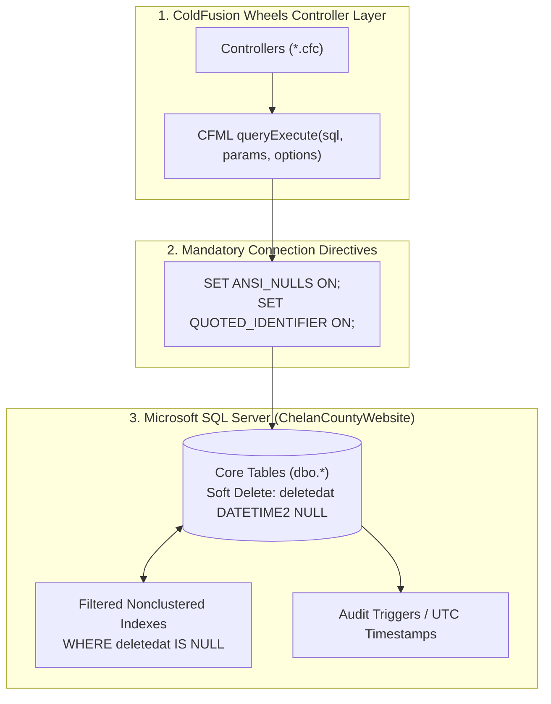

# Series 008: Database Schema & SQL Server Standards
**Location:** `.doclib/008_DATABASE_SCHEMA_AND_SQL_SERVER_STANDARDS.md`  
**Parent Index:** [000_SERIES_INDEX.md](file:///c:/inetpub/CMSAdmin2.0/.doclib/000_SERIES_INDEX.md)  
**Classification:** Core Relational Architecture & Database Engineering Standard  
**Version Parity:** v2.1.325+  
**Target Audience:** Database Administrators, Backend Engineers, Full-Stack Developers

---

## 1. Executive Summary & Datasource Configuration

Chelan County CMSAdmin 2.0 is powered by a high-throughput Microsoft SQL Server (2019 / 2022) relational backend. All database interactions execute against the primary application datasource:

- **Datasource Name:** `ChelanCountyWebsite`
- **Dialect:** Microsoft SQL Server Transact-SQL (T-SQL)
- **Execution Engine:** CFML `queryExecute()` with parameterized structs
- **Collation:** `SQL_Latin1_General_CP1_CI_AS` (case-insensitive, accent-sensitive)
- **Timezone Standard:** Strict **UTC (`SYSUTCDATETIME()`)** across all relational tables



---

## 2. Mandatory SQL Server Invariant (Msg 1934 Prevention)

The tables in `ChelanCountyWebsite` make extensive use of **filtered nonclustered indexes** with the predicate `WHERE deletedat IS NULL`. This design allows natural unique constraints (such as unique URL slugs within a department workspace) while fully supporting soft-deleted historical records.

> [!CAUTION]
> **CRITICAL INVARIANT:**  
> Microsoft SQL Server strictly requires `QUOTED_IDENTIFIER` and `ANSI_NULLS` to be `ON` for any query that touches a table containing filtered indexes. Failing to prepend these connection directives will cause SQL Server to abort query execution with error:
> ```
> Msg 1934, Level 16, State 1: 
> INSERT/UPDATE failed because the following SET options have forbidden settings: 'QUOTED_IDENTIFIER, ANSI_NULLS'.
> ```

### Standard Query Template for All DML Operations
Every `INSERT`, `UPDATE`, or `DELETE` query touching tables with filtered indexes **must** follow this exact format:

```cfm
local.q = queryExecute("
    SET ANSI_NULLS ON;
    SET QUOTED_IDENTIFIER ON;

    UPDATE dbo.pages SET
        PageTitle = :title,
        ContentHtml = :content,
        updatedat = SYSUTCDATETIME()
    WHERE ContentID = :id
      AND deletedat IS NULL
", {
    title:   { value: local.title,   cfsqltype: "cf_sql_nvarchar" },
    content: { value: local.content, cfsqltype: "cf_sql_nvarchar" },
    id:      { value: local.id,      cfsqltype: "cf_sql_integer" }
}, { datasource: "ChelanCountyWebsite" });
```

---

## 3. Relational Table Catalog & Master Schema

| Table Name | Primary Key | Description | Series Ref |
| :--- | :--- | :--- | :--- |
| `dbo.pages` | `ContentID` (INT) | Primary municipal page hierarchy, layout wireframes, cover images | [006](file:///c:/inetpub/CMSAdmin2.0/.doclib/006_PAGES_AND_REVISION_HISTORY_STUDIO.md) |
| `dbo.page_revisions` | `id` (INT) | RCW 42.56 historical audit snapshots, LCS diffs, and rollback backups | [006](file:///c:/inetpub/CMSAdmin2.0/.doclib/006_PAGES_AND_REVISION_HISTORY_STUDIO.md) |
| `dbo.articles` | `id` (INT) | Public news announcements, press releases, cover photos, taxonomies | [005](file:///c:/inetpub/CMSAdmin2.0/.doclib/005_ARTICLES_AND_PUBLIC_INFORMATION.md) |
| `dbo.article_categories`| `id` (INT) | Color-coded category taxonomies with slug routing | [005](file:///c:/inetpub/CMSAdmin2.0/.doclib/005_ARTICLES_AND_PUBLIC_INFORMATION.md) |
| `dbo.article_tags` | `id` (INT) | Searchable keyword tags indexed by workspace | [005](file:///c:/inetpub/CMSAdmin2.0/.doclib/005_ARTICLES_AND_PUBLIC_INFORMATION.md) |
| `dbo.emergency_alerts`| `id` (INT) | Public safety emergency incident banners, quick-dispatch presets | [007](file:///c:/inetpub/CMSAdmin2.0/.doclib/007_EMERGENCY_ALERTS_AND_INCIDENTS.md) |
| `dbo.media_assets` | `id` (INT) | Relational index of physical filesystem assets, alt text, SHA-256 | [004](file:///c:/inetpub/CMSAdmin2.0/.doclib/004_MEDIA_LIBRARY_AND_FILE_EXPLORER.md) |
| `dbo.forms` | `id` (INT) | Dynamic online forms, drag-and-drop field schema definitions | [000](file:///c:/inetpub/CMSAdmin2.0/.doclib/000_SERIES_INDEX.md) |
| `dbo.form_submissions`| `id` (INT) | Encrypted form submission records, citizen inputs, file attachments | [000](file:///c:/inetpub/CMSAdmin2.0/.doclib/000_SERIES_INDEX.md) |
| `dbo.rfps` | `id` (INT) | Solicitations, RFPs, bids, addenda, and planholder registries | [011](file:///c:/inetpub/CMSAdmin2.0/.doclib/011_RFP_AND_SOLICITATIONS_MANAGER.md) |
| `dbo.job_postings` | `id` (INT) | HRM job vacancies, salary schedules, and employment applications | [010](file:///c:/inetpub/CMSAdmin2.0/.doclib/010_SCHEDULED_PUBLISHING_AND_EXPIRATION_WORKER.md) |
| `dbo.calendar_events` | `id` (INT) | Public hearings, commissioner dockets, and county office holidays | [010](file:///c:/inetpub/CMSAdmin2.0/.doclib/010_SCHEDULED_PUBLISHING_AND_EXPIRATION_WORKER.md) |
| `dbo.cms_users` | `id` (INT) | Administrative staff accounts, 2FA TOTP secrets, RBAC roles | [001](file:///c:/inetpub/CMSAdmin2.0/.doclib/001_SYSTEM_ARCHITECTURE.md) |
| `dbo.cms_workspaces` | `id` (INT) | Multi-tenant department workspaces, storage paths, domains, branding | [001](file:///c:/inetpub/CMSAdmin2.0/.doclib/001_SYSTEM_ARCHITECTURE.md) |

---

## 4. CFML Parameter Typing (`cfsqltype`) Standards

To eliminate SQL injection vulnerabilities and avoid Unicode data corruption, all `queryExecute()` statements **must** pass strictly typed parameter structs:

| SQL Server Column Type | Required `cfsqltype` | Critical Rule & Rationale |
| :--- | :--- | :--- |
| `INT`, `BIGINT`, `SMALLINT` | `cf_sql_integer` / `cf_sql_bigint` | Cast with `Val(val)` before binding. |
| `NVARCHAR(n)`, `NVARCHAR(MAX)` | `cf_sql_nvarchar` | **Mandatory:** Never use `cf_sql_varchar` or `cf_sql_longvarchar` on `NVARCHAR` columns. Single-byte bindings corrupt multi-byte Unicode characters (emojis, curly quotes, accents) into literal question marks (`?`). |
| `VARCHAR(n)` | `cf_sql_varchar` | ASCII strings, tokens, hashes. |
| `BIT` | `cf_sql_bit` | Pass `1` or `0`. |
| `DATETIME2`, `DATETIME` | `cf_sql_timestamp` | Validate with `IsDate(val)` prior to binding; pass `null: !IsDate(val)` for optional fields. |
| `DECIMAL(p,s)`, `MONEY` | `cf_sql_decimal` / `cf_sql_money` | Financial amounts, fees, bid deposits. |

---

## 5. Soft-Delete Standard & Audit Column Convention

In adherence to statutory retention mandates (RCW 42.56), physical `DELETE FROM` statements are prohibited for content records. Every content table must implement this standard audit footprint:

```sql
[createdat]   DATETIME2(7) NOT NULL CONSTRAINT [DF_table_createdat] DEFAULT (SYSUTCDATETIME()),
[updatedat]   DATETIME2(7) NOT NULL CONSTRAINT [DF_table_updatedat] DEFAULT (SYSUTCDATETIME()),
[deletedat]   DATETIME2(7) NULL,
[created_by]  NVARCHAR(255) NULL,
[modified_by] NVARCHAR(255) NULL
```

### Soft-Delete Execution Pattern
```cfm
queryExecute("
    SET ANSI_NULLS ON;
    SET QUOTED_IDENTIFIER ON;

    UPDATE dbo.articles SET
        deletedat = SYSUTCDATETIME(),
        modified_by = :actor,
        updatedat = SYSUTCDATETIME()
    WHERE id = :id
      AND deletedat IS NULL
", {
    actor: { value: session.user.full_name, cfsqltype: "cf_sql_varchar" },
    id:    { value: local.id,               cfsqltype: "cf_sql_integer" }
}, { datasource: "ChelanCountyWebsite" });
```

---

## 6. Multi-Tenant Workspace Scoping Schema (`dbo.cms_workspaces`)

```sql
CREATE TABLE dbo.cms_workspaces (
    [id]                   INT IDENTITY(1,1) NOT NULL PRIMARY KEY,
    [code]                 NVARCHAR(50) NOT NULL,
    [name]                 NVARCHAR(150) NOT NULL,
    [alias]                NVARCHAR(50) NULL,
    [type]                 NVARCHAR(20) NOT NULL DEFAULT 'dept', -- 'dept', 'site', 'global'
    [badge]                NVARCHAR(50) NULL,
    [badge_class]          NVARCHAR(50) NULL,
    [icon]                 NVARCHAR(50) NULL,
    [description]          NVARCHAR(500) NULL,
    [folder_path]          NVARCHAR(255) NULL,
    [virtual_directory]    NVARCHAR(100) NULL,
    [redirect_url]         NVARCHAR(255) NULL,
    [department]           NVARCHAR(150) NULL,
    [department_category]  NVARCHAR(100) NULL,
    [storage_path]         NVARCHAR(255) NULL,  -- e.g. 'files/assessor'
    [domain_name]          NVARCHAR(255) NULL,  -- e.g. 'www.chelancounty.gov'
    [project_path]         NVARCHAR(255) NULL,  -- e.g. 'C:\inetpub\chelan-county'
    [leadership_type]      NVARCHAR(20) NULL DEFAULT 'dept_head', -- 'elected' or 'dept_head'
    [job_title]            NVARCHAR(150) NULL,
    [contact_photo]        NVARCHAR(500) NULL,
    [contact_first_name]   NVARCHAR(100) NULL,
    [contact_last_name]    NVARCHAR(100) NULL,
    [contact_email]        NVARCHAR(150) NULL,
    [contact_phone]        NVARCHAR(50) NULL,
    [contact_fax]          NVARCHAR(50) NULL,
    [address]              NVARCHAR(255) NULL,
    [address2]             NVARCHAR(255) NULL,
    [city]                 NVARCHAR(100) NULL DEFAULT 'Wenatchee',
    [state]                NVARCHAR(50) NULL DEFAULT 'WA',
    [zip]                  NVARCHAR(20) NULL DEFAULT '98801',
    [office_hours]         NVARCHAR(500) NULL,
    [color]                NVARCHAR(20) NULL DEFAULT '#0073AA',
    [is_active]            BIT NOT NULL DEFAULT 1,
    [is_system]            BIT NOT NULL DEFAULT 0,
    [sort_order]           INT NOT NULL DEFAULT 100,
    [createdat]            DATETIME2(7) NOT NULL DEFAULT SYSUTCDATETIME(),
    [updatedat]            DATETIME2(7) NOT NULL DEFAULT SYSUTCDATETIME(),
    [deletedat]            DATETIME2(7) NULL
);

CREATE UNIQUE NONCLUSTERED INDEX [IX_cms_workspaces_code] 
ON [dbo].[cms_workspaces] ([code])
WHERE [deletedat] IS NULL;
```

---

## 7. Transaction Management (`cftransaction`)

When multiple related tables are mutated in a single business flow (such as saving a page and snapshotting its revision, or creating an RFP with initial planholder records), operations **must** be wrapped in a transaction block to prevent orphaned child rows:

```cfm
transaction action="begin" {
    try {
        // Step 1: Update primary record
        queryExecute("SET ANSI_NULLS ON; SET QUOTED_IDENTIFIER ON; UPDATE dbo.pages ...", ...);

        // Step 2: Insert revision snapshot
        queryExecute("SET ANSI_NULLS ON; SET QUOTED_IDENTIFIER ON; INSERT INTO dbo.page_revisions ...", ...);

        transaction action="commit";
    } catch (any e) {
        transaction action="rollback";
        writeLog(type="error", file="database", text="Transaction failed: #e.message# #e.detail#");
        rethrow;
    }
}
```
