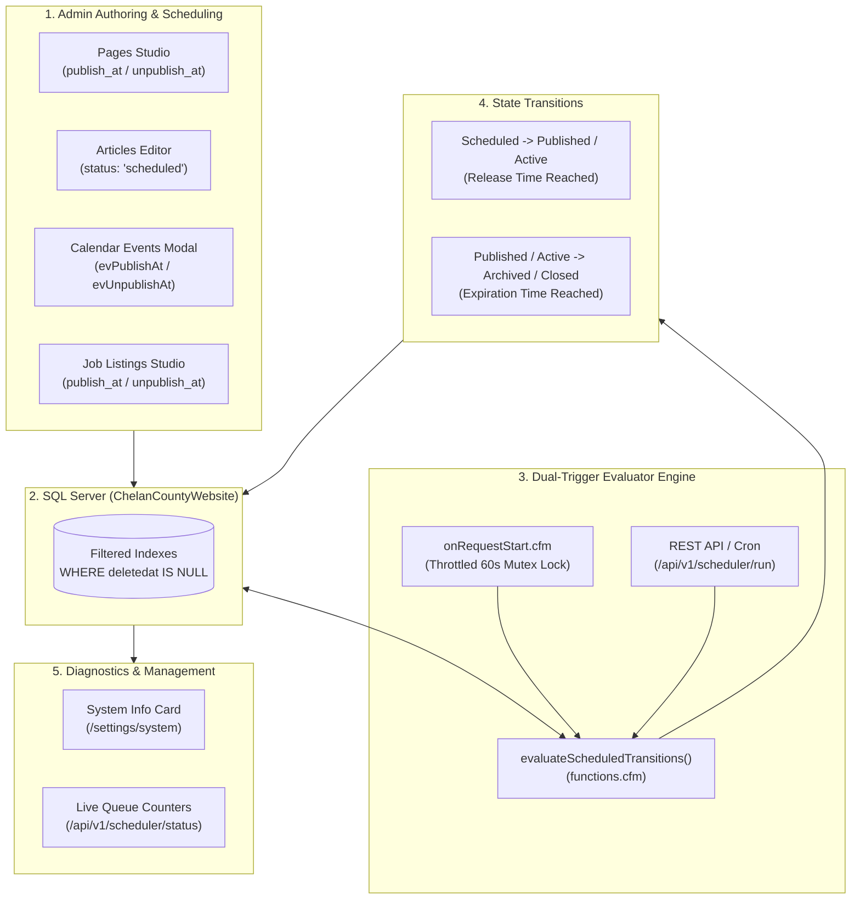

# Series 010: Scheduled Publishing & Automated Expiration System
**Location:** `.doclib/010_SCHEDULED_PUBLISHING_AND_EXPIRATION_WORKER.md`  
**Parent Index:** [000_SERIES_INDEX.md](file:///c:/inetpub/CMSAdmin2.0/.doclib/000_SERIES_INDEX.md)  
**Classification:** Core Workflow & Automation Subsystem

---

## 1. Executive Summary

The **Scheduled Publishing & Automated Expiration Subsystem** governs the time-based lifecycle of official Chelan County digital content across **Pages**, **Articles / Press Releases**, **Calendar Events & Public Hearing Notices**, and **Job Postings & Careers**. 

It enables county departments (Public Works, Community Development, Commissioners, HRM, Sheriff) to author announcements in advance for statutory release dates (such as election dates, RFP bid closures, seasonal road closures, and legal notices) and have content automatically archive or unpublish without manual intervention.

---

## 2. Architectural Blueprint & Operational Flow



---

## 3. Database Schema & Index Specifications

All tables use `DATETIME2 NULL` for precision and filtered nonclustered indexes for high throughput evaluation during periodic sweeps.

### Filtered Indexes Created (`WHERE deletedat IS NULL`):
1. **`dbo.pages`**:
   - `publish_at`, `unpublish_at`
   - Synchronized with legacy `PublishAt` and `UnpublishAt`
   - Filtered index: `IX_pages_scheduled_publishing`
2. **`dbo.articles`**:
   - `publish_at`, `unpublish_at`
   - Synchronized with `published_at`
   - Filtered index: `IX_articles_scheduled_publishing`
3. **`dbo.calendar_events`**:
   - `publish_at`, `unpublish_at`
   - Filtered index: `IX_calendar_events_scheduled_publishing`
4. **`dbo.job_listings`**:
   - `publish_at`, `unpublish_at`
   - Synchronized with `PostDate` and `ApplicationDeadline`
   - Filtered index: `IX_job_listings_scheduled_publishing`
5. **`dbo.job_postings`**:
   - `publish_at`, `unpublish_at`
   - Synchronized with `open_date` and `close_date`
   - Filtered index: `IX_job_postings_scheduled_publishing`

> [!IMPORTANT]
> **SQL Server Filtered Indexes Invariant:**  
> Every query interacting with these tables must prepend:
> ```sql
> SET ANSI_NULLS ON; SET QUOTED_IDENTIFIER ON;
> ```
> Failure to set these connection options causes SQL Server error `Msg 1934: UPDATE failed because QUOTED_IDENTIFIER is OFF`.

---

## 4. Evaluator Execution Engine

The core evaluation logic lives in `app/global/functions.cfm`:

### Primary Functions:
1. **`evaluateScheduledTransitions()`**:
   - Queries items whose `publish_at <= SYSUTCDATETIME()` and transitions them from `Scheduled` &rarr; `Published` / `Active`.
   - Queries items whose `unpublish_at <= SYSUTCDATETIME()` and transitions them from `Published` / `Active` &rarr; `Archived` / `Closed` / `Hidden`.
   - Records `modified_by = 'Auto-Scheduler'` or `ModifiedBy = 'Auto-Scheduler'`.
   - Returns a structured execution report struct:
     ```json
     {
       "success": true,
       "total_transitions": 1.0,
       "pages_published": 0,
       "pages_archived": 0,
       "articles_published": 1,
       "articles_archived": 0,
       "events_published": 0,
       "events_archived": 0,
       "jobs_published": 0,
       "jobs_archived": 0,
       "timestamp": "October, 16 2026 18:46:13",
       "errors": []
     }
     ```

2. **`getScheduledPublishingSummary()`**:
   - Computes pending counters across all 4 modules (`pages_scheduled`, `pages_expiring`, `articles_scheduled`, `articles_expiring`, `events_scheduled`, `events_expiring`, `jobs_scheduled`, `jobs_expiring`, `total_pending_actions`).
   - Retrieves `last_run` timestamp and `last_result` execution payload.

---

## 5. Dual Execution Triggers

### A. Throttled Request-Level Worker (`onRequestStart.cfm`)
- Embedded in `app/events/onrequeststart.cfm`.
- Automatically executes on incoming web requests if at least **60 seconds** have passed since the last run.
- Guarded by CFML named mutex lock `application.schedulerLock` with a 0-second timeout to ensure that concurrent HTTP requests never execute overlapping sweeps.

### B. REST API & External Scheduled Task
For headless environments, Windows Task Scheduler, or Lucee `cfschedule`:
- **Execute Evaluator:**
  - `GET` or `POST` `/api/v1/scheduler/run`
  - Internal logged-in route: `/scheduler/run`
- **Inspect Queue Telemetry:**
  - `GET` `/api/v1/scheduler/status`
  - Internal logged-in route: `/scheduler/status`

---

## 6. Where to Find & Manage the Scheduler in CMSAdmin

### Web Interface:
1. **System Telemetry & Manual Run:**
   - URL: **[`http://cmsadmin.chelancounty.gov/settings/system`](http://cmsadmin.chelancounty.gov/settings/system)**
   - Navigation: **Settings &bull; Diagnostics** &rarr; Card 5: **Automated Publishing & Expiration Worker**.
   - Features: Real-time counter pills for each content queue, last execution timestamp, and the **"Run Evaluator Now"** manual dispatch button.

2. **Pages Module:**
   - Editor URL: `/pages/edit?id={contentId}` &rarr; **Section 2 (Publishing, Status & Template)**.
   - Field: `pgUnpublishAt` ("Unpublish / Expire On").

3. **Articles Module:**
   - Directory: `/articles` &rarr; Displays the **Scheduled** KPI card and status filter badge.
   - Editor: `/articles/edit?id={id}` &rarr; **Publishing Options** &rarr; Status dropdown includes `Scheduled (Auto-Publish)`, plus `unpublishAt` ("Unpublish / Archive At").

4. **Events Module:**
   - Directory: `/events` &rarr; Filter dropdown supports `Scheduled` and `Archived`.
   - Event Modal: **Section 2 (Date & Schedule)** includes:
     - `evPublishAt` ("Publish At - Automated Release")
     - `evUnpublishAt` ("Unpublish / Archive At - Automatic Expiration")

5. **Careers / Job Postings Module:**
   - Directory: `/jobs` &rarr; Displays the **Scheduled (Future)** KPI stat card, status filter option, and badge styling.
   - Editor: `/jobs/edit?id={jobId}` &rarr; **Status & Timeline** card includes `publish_at` and `unpublish_at` datetime pickers. Automatically sets status to `Scheduled` if `publish_at` is set in the future.

---

## 7. Verification & Audit Trail

- **DDL Migration Script:** [`config/sql/schema-scheduled-publishing.sql`](file:///c:/inetpub/CMSAdmin2.0/config/sql/schema-scheduled-publishing.sql)
- **Controller Implementation:** [`app/controllers/Scheduler.cfc`](file:///c:/inetpub/CMSAdmin2.0/app/controllers/Scheduler.cfc)
- **Activity Log Entry:** Recorded under October 16, 2026 in [002_ACTIVITY_SUMMARY_AND_CHANGELOG.md](file:///c:/inetpub/CMSAdmin2.0/.doclib/002_ACTIVITY_SUMMARY_AND_CHANGELOG.md).

