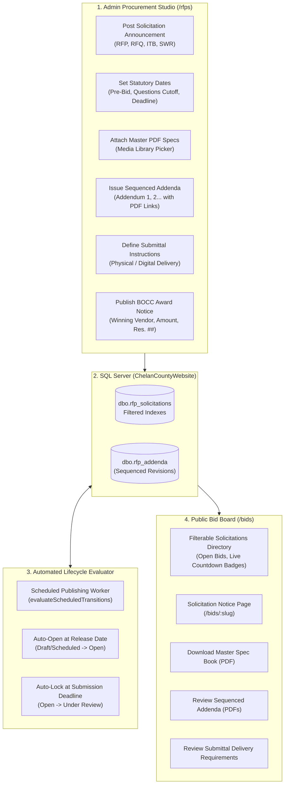

# Series 011: RFP & Solicitations Management Module
**Location:** `.doclib/011_RFP_AND_SOLICITATIONS_MANAGER.md`  
**Parent Index:** [000_SERIES_INDEX.md](file:///c:/inetpub/CMSAdmin2.0/.doclib/000_SERIES_INDEX.md)  
**Classification:** Core Procurement & Statutory Solicitation Subsystem

---

## 1. Executive Summary

The **RFP & Solicitations Management Module** provides Chelan County with a streamlined, announcement-first municipal procurement and bidding platform conforming to Washington State statutory notice mandates:
- **RCW 39.04** — Public Works Contracts (Formal advertised bids, prevailing wages, bid bonds, retainage).
- **RCW 39.80** — Contracts for Architectural and Engineering Services (RFQ qualifications-based selection).
- **RCW 36.32** — County Commissioners purchasing thresholds and competitive bid awards.
- **RCW 42.56** — Public Records Act (Public disclosure of solicitation packets and award notices).

### Scope Boundary & Architectural Intent
Chelan County does **not** manage sealed bids or online vendor submissions through the CMS, as this would require vendor accounts, authentication portals, and complex procurement ERP workflows. Instead, the system acts as an authoritative **Solicitation & Announcement Board**:
1. Post public announcements with clear scopes of work.
2. Provide direct downloads for master specification books, geotechnical reports, and project drawings via the [Media Library Picker](file:///c:/inetpub/CMSAdmin2.0/.doclib/004_MEDIA_LIBRARY_AND_FILE_EXPLORER.md).
3. Distribute sequenced addenda (`Addendum #1`, `Addendum #2`, etc.) with PDF attachments.
4. Clearly state submission instructions and delivery requirements (e.g., physical sealed envelopes delivered to Public Works reception or designated department emails).
5. Disclose Board of County Commissioners (BOCC) award resolutions and bid tabulation PDFs once awarded.

---

## 2. Procurement Architecture & Operational Flow



---

## 3. Procurement Types & Classification

| Type Code | Display Label | Statutory Basis & County Governance |
|---|---|---|
| `ITB` | **Invitation to Bid / Call for Bids** | **RCW 39.04** Formal advertised bidding for Public Works infrastructure (road reconstruction, bridges, drainage, paving). Evaluated on lowest responsive and responsible bidder. |
| `RFP` | **Request for Proposals** | Competitive negotiation for services, software, and technology solutions. Evaluated on qualitative technical criteria and total cost. |
| `RFQ` | **Request for Qualifications** | **RCW 39.80** Architecture, engineering, and land surveying. Qualifications-based selection (QBS); price is negotiated after ranking. |
| `SWR` | **Small Works Roster** | Expedited public works projects below statutory thresholds utilizing pre-qualified roster contractors. |
| `SOQ` | **Statement of Qualifications** | Annual or multi-year master consultant rosters. |
| `NOTICE` | **Sole Source / Intent to Award** | Mandatory statutory public notice prior to non-competitive or emergency contract execution. |

---

## 4. Key Subsystem Capabilities

### A. Unified 2-Column Admin Studio
- **Announcement Information:** Project title, solicitation number, workspace/department, summary, and rich-text scope of work.
- **Clean Single-Line URL Slug Input:** Displays standard `https://chelancounty.gov/bids/` prefix in a fixed nowrap container with borderless monospace slug input and live preview.
- **Document Attachments & Addenda:** One-click integration with the local Media Picker for primary spec books and sequenced addenda PDFs.
- **Submittal Instructions:** Delivery method (Physical sealed packet, Email, or Online portal) with packaging guidelines.
- **Statutory Deadlines & Contact:** Publication date, pre-bid meeting (with mandatory checkbox and location), questions cutoff, submission deadline with live urgency countdown, and public bid opening details.

### B. Public Bid Board (`/bids`)
- Clean, ADA WCAG 2.1 AA accessible directory of all public solicitations.
- Status filters (`Open`, `Under Review`, `Awarded`, `All`), type filters, department filters, and search bar.
- Urgency countdown badges (`Open • 12 Days Left`, `Closes Today!`, `Closed • Under Evaluation`).

### C. Public Solicitation Notice (`/bids/[slug]`)
- Fast, clean announcement template without vendor registration friction.
- Prominent primary specifications PDF download button.
- Numbered addenda and clarification cards with individual PDF downloads.
- Dedicated "How to Submit" card detailing delivery location, envelope markings, and submission cutoff.
- Project inquiries card with issuing department contact information.

---

## 5. Database Schema Specifications

The module operates on tables in `ChelanCountyWebsite` with filtered indexes:
- `dbo.rfp_solicitations`: Core solicitations with workspace scoping, dates, budget estimates, submittal instructions, status, and BOCC award fields.
- `dbo.rfp_addenda`: Sequenced addenda entries with cascade deletion and PDF attachments.

All DDL and DML operations strictly observe the mandatory invariant:
```sql
SET ANSI_NULLS ON; SET QUOTED_IDENTIFIER ON;
```

---

## 6. Endpoints & Route Map

| Verb | Path | Controller##Action | Access Level | Description |
|---|---|---|---|---|
| `GET` | `/rfps` | `rfps##index` | Admin | Directory dashboard with KPI metrics, filters, and management table |
| `GET` | `/rfps/new` | `rfps##new` | Admin | Studio to create and announce a new solicitation |
| `GET` | `/rfps/edit` | `rfps##edit` | Admin | Unified 2-column editing studio (Scope, Specs, Addenda, Dates, Contacts) |
| `POST` | `/rfps/save` | `rfps##save` | Admin | Parameterized trigger-safe INSERT / UPDATE handler |
| `POST` | `/rfps/delete` | `rfps##delete` | Admin | Soft-delete solicitation (`deleted_at = SYSUTCDATETIME()`) |
| `POST` | `/rfps/status` | `rfps##updateStatus` | Admin | Fast inline status switcher |
| `POST` | `/rfps/addendum/save` | `rfps##saveAddendum` | Admin | Create or update numbered addendum |
| `POST` | `/rfps/addendum/delete` | `rfps##deleteAddendum` | Admin | Remove addendum |
| `GET` | `/bids` | `rfps##publicList` | Public | Public bid board with countdown badges and search |
| `GET` | `/bids/view` | `rfps##publicView` | Public | Public solicitation notice by `?id=` or `?slug=` |
| `GET` | `/bids/[slug]` | `rfps##publicView` | Public | Clean RESTful solicitation notice |
