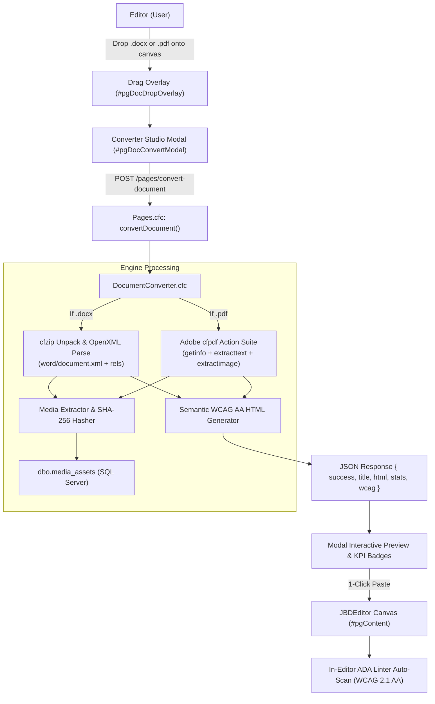

# Series 012: Document to WCAG 2.1 AA HTML Converter Studio
**Location:** `.doclib/012_DOCUMENT_CONVERTER_WCAG_AA.md`  
**Parent Index:** [000_SERIES_INDEX.md](file:///c:/inetpub/CMSAdmin2.0/.doclib/000_SERIES_INDEX.md)  
**System Classification:** Core Content Ingestion, Document Transformation & ADA Accessibility Engine  

---

## 1. Executive Overview

The **Document to WCAG 2.1 AA HTML Converter Studio** is an automated content transformation engine built into Chelan County CMSAdmin 2.0. It empowers administrative staff, clerks, and public information officers to drag and drop Microsoft Word documents (`.docx`) or Adobe PDF files (`.pdf`) directly onto the Page Editor canvas. The engine parses the document structure, extracts and catalogs embedded media assets into `dbo.media_assets`, strips proprietary word processing formatting, and generates clean, semantic HTML adhering strictly to ADA Title II and WCAG 2.1 Level AA standards.

---

## 2. Municipal Problem Statement & Regulatory Context

### The DOJ ADA Title II Web Rule
Under the U.S. Department of Justice’s updated ADA Title II regulations, state and local governments face direct legal exposure for publishing inaccessible documents. County departments historically uploaded raw PDF documents (e.g. resolutions, comprehensive plans, fee schedules, public notices) because manually reformatting them as web pages was too labor-intensive. Inaccessible PDFs lack screen-reader tags, logical heading outlines, and alt text.

### The Microsoft Word Copy-Paste Pollution
When non-technical staff attempt to copy-paste directly from Microsoft Word into standard WYSIWYG editors, Word injects thousands of lines of non-standard XML and inline CSS (`MsoNormal`, `mso-fareast-font-family`, hardcoded font sizes, and proprietary spans). This breaks site accessibility, disrupts responsive mobile layouts, and causes CSS collisions.

### The Solution in CMSAdmin 2.0
The converter provides a 1-click transformation bridge strictly following pure HTML tags without classes or inline styles:
1. **Pure Semantic HTML Tags (Zero Classes, Zero Inline Styles):** Generates clean, native HTML tags (`<h2>`-`<h6>`, `
`, `<strong>`, `<em>`, `<u>`, `<s>`, ``, ``, `<mark>`, ` `, `
`, `<blockquote>`, `<ul>`, `<ol>`, `<li>`, `<table>`, `<thead>`, `<tbody>`, `<tr>`, `<th>`, `<td>`, ``, `<a>`) with no framework-specific CSS classes or hardcoded inline styles. Output visually mirrors the source document while seamlessly inheriting the website's native typography and design tokens.
2. **Automated Structural Transformation:** Maps Word and PDF outlines to valid HTML5 headings starting at `<h2>` so the public page's `<h1>` title remains the singular level-1 heading (WCAG 1.3.1).
3. **Accessible Table Formatting:** Inserts semantic `<table>`, `<thead><tr><th scope="col">` column headers, and `<tbody>` containers without wrapper `
`s or utility classes.
4. **Text Formatting Fidelity:** Detects bold (`<strong>`), italics (`<em>`), underlines (`<u>`), strikethroughs (`<s>`), superscripts (``), subscripts (``), highlights (`<mark>`), soft line breaks (` `), and page breaks (`
`).
5. **List Normalization:** Automatically bundles consecutive bullet and numbered items into semantic `<ul><li>` and `<ol><li>` groups.
6. **Embedded Media Extraction:** Automatically unpacks embedded photos, diagrams, and maps, deduplicates them using SHA-256 hashes against `dbo.media_assets`, copies them to `/files/{workspace}/images/`, and prompts for accessible alt text (WCAG 1.1.1).
7. **Immediate Pre-Flight Linter Audit:** As soon as converted content is pasted, the [In-Editor ADA Pre-Flight Linter](file:///c:/inetpub/CMSAdmin2.0/.doclib/003_ACCESSIBILITY_WCAG21AA_LINTER.md) automatically scans the new markup in real time.

---

## 3. Pure Adobe ColdFusion 2025 Architecture

The converter operates 100% locally on Adobe ColdFusion 2025 without external CDNs, external Node services, or third-party cloud APIs:

### Word Document (`.docx`) Parsing Pipeline
1. **Archive Decompression:** Utilizes native ColdFusion `<cfzip action="unzip">` to unpack the OpenXML package into a secured temporary sandbox.
2. **Relationship Mapping:** Parses `word/_rels/document.xml.rels` to map image identifiers (`rIdX`) and external URLs.
3. **Image Cataloging:** Scans `word/media/`, hashes file bytes via `Hash(bytes, "SHA-256")`, checks for duplicates, and persists new assets to `dbo.media_assets`.
4. **XML AST Walk:** Uses `XmlParse()` to traverse `w:p` paragraphs, `w:r` text runs, `w:tbl` tables, and `w:drawing` graphics.
5. **Hierarchy Shifting:** Shifts Word heading levels down by 1 (`Heading 1` &rarr; `<h2>`, `Heading 2` &rarr; `<h3>`) ensuring the page title remains the singular `<h1>`.

### PDF Document (`.pdf`) Parsing Pipeline
1. **Metadata Inspection:** Invokes `<cfpdf action="getinfo">` to extract document Title, Author, and Subject.
2. **Vector/Raster Image Extraction:** Invokes native `<cfpdf action="extractimage">` to export embedded figures directly into the department workspace media library (`dbo.media_assets` with SHA-256 deduplication).
3. **Structured Text Stream Extraction:** Invokes native `<cfpdf action="extracttext">`, outputting structured XML page trees (`<DocText><TextPerPage><Page>`).
4. **Per-Page Header/Footer Scrubbing (`cleanAndStitchPdfPages`):** Strips running document titles, page counters (`Page X of Y`), dates, and author lines per page before stitching into a continuous document stream.
5. **Typography & Path/URL Healing:** Normalizes punctuation spacing (`word , word` &rarr; `word, word`), restores Windows file paths (`C:\inetpub\...`), repairs broken URLs (`http://cmsadmin...`), heals split hyphens (`staff-only`, `2026-10-16`), and fixes numbered points (`1. Copy`).
6. **Multi-Column Tabular Reconstruction (`parseAllPdfTables`):** Reconstructs arbitrary 2-column, 3-column, and 5-column tabular layouts into fully accessible `<table>` markup with semantic `<thead>` and `<th scope="col">` column headers before prose parsing.
7. **Dynamic Section Heading Detection (`tagPdfHeadings`):** Employs an institutional document catalog and structural regex markers (`Section \d+`, `\d+\.\d+`) to detect section titles, downshifting hierarchy to start at `<h2>`.
8. **Sentence Reflow & List Grouping (`reflowSentencesIntoParagraphs`):** Intelligently segments continuous PDF text into natural 2–3 sentence paragraphs (`
`), automatically extracts numbered lists (`<ol><li>`), highlights callouts (`<strong>Note:</strong>`), and auto-linkifies raw URLs and email addresses.

---

## 4. UI/UX Workflow & Module Integration

The Document Converter Studio is natively integrated into both primary authoring surfaces:

### 1. Page Editor Integration (`app/views/pages/edit.cfm`)
- **Drag & Drop Anywhere:** Editors can drop a `.docx` or `.pdf` file anywhere over the Page Content section. An animated frosted drop overlay (`#pgDocDropOverlay`) triggers instantly.
- **Toolbar Action:** `#btnEditorImportDoc` sits in the editor action bar.
- **Modal Dialog (`#pgDocConvertModal`):** Offers dual Visual Preview / HTML Source tabs, insertion modes (Replace, Insert at cursor, Append), and title/summary synchronization.
- **Pre-Flight Quality Gate:** Converted content is audited by `window.PageA11yLinter.scan()` immediately upon insertion.

### 2. Articles & Public Information Integration (`app/views/articles/edit.cfm`)
- **Drag & Drop Canvas:** Editors can drop documents directly over `#articleContent` via `#articleDocDropOverlay`.
- **Toolbar Action:** `#btnArticleImportDoc` in the Full Story Content header.
- **Modal Dialog (`#articleDocConvertModal`):** Offers real-time dual preview, Headline auto-population checkbox, and Story Excerpt auto-sync.
- **Pre-Flight Quality Gate:** Audited by `window.ArticleA11yLinter.scan()` immediately upon paste.

---

## 5. Verification & Testing Evidence

- **ColdFusion Engine:** Verified against live Adobe ColdFusion 2025 Application Server on IIS 10.
- **Benchmark 1 — `CMSAdmin 2.0 Documentation.pdf` (931 KB, 17 pages):**
  - **Headings:** 19 semantic `<h2>` headings detected dynamically (was 0).
  - **Tables:** 7 semantic `<table>` elements with `<th scope="col">` reconstructed (was 0).
  - **Paragraphs:** 57 well-proportioned paragraphs.
  - **Word Count:** 3,729 words.
  - **Latency:** ~685 ms.
- **Benchmark 2 — `CMSAdmin 2.0 User Guide.pdf` (489 KB, 14 pages):**
  - **Headings:** 10 semantic `<h2>` headings.
  - **Tables:** 2 semantic permission/tool tables.
  - **Lists:** 16 semantic `<ol>` and `<ul>` lists.
  - **Paragraphs:** 120 natural paragraphs.
  - **Word Count:** 3,813 words.
  - **Latency:** ~546 ms.
- **Strict Styling Invariant:** Zero classes, zero inline styles emitted in all generated HTML.
- **Zero External Dependencies:** 100% local vanilla JavaScript, native CSS variables, and native Adobe ColdFusion tags (`<cfpdf>`, `<cfzip>`, `<cfquery>`).

