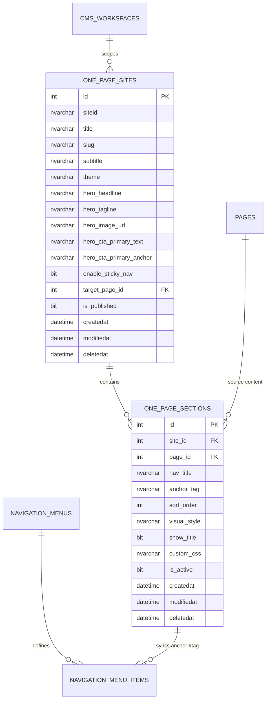
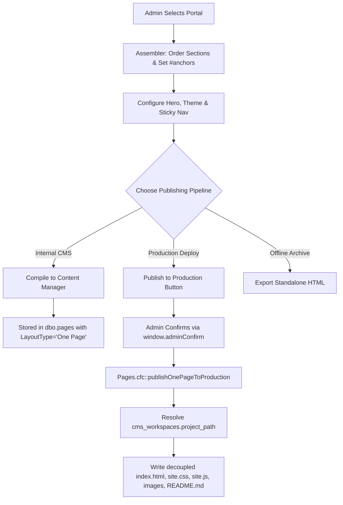

# Series 013: One Page Studio & Portal Builder

**Location:** `.doclib/013_ONE_PAGE_STUDIO_AND_PORTAL_BUILDER.md`  
**Parent Index:** [000_SERIES_INDEX.md](file:///c:/inetpub/CMSAdmin2.0/.doclib/000_SERIES_INDEX.md)  
**Classification:** Core Functional Specification & Architectural Blueprint  
**Version Parity:** v2.3.0+  
**Target Audience:** Front-End Engineers, CMS Administrators, Web Architects, Full-Stack Developers  

---

## 1. Executive Summary & Purpose

The **One Page Studio** is a municipal web portal publishing subsystem within Chelan County CMSAdmin 2.0. It empowers public information officers, department coordinators, and portal managers to assemble and publish responsive, single-page websites (such as `WenatcheeRiverPark.org`, `OhmeGardens.org`, or departmental landing portals) by aggregating multiple standalone pages into cohesive, stacked sections with smooth-scrolling hash (`#anchor`) navigation.

### Key Objectives
1. **Multi-Page Section Aggregation:** Rapidly select multiple existing pages from any department workspace or portal and compile them into a seamless single-page layout.
2. **Anchor Tag (`#tag`) Menu Integration:** Full synchronization between page section anchors (`#overview`, `#amenities`, `#rates`, `#park-maps`, `#contact`) and the Navigation Manager side/top menu builder.
3. **WCAG 2.1 AA Compliance:** Automatically structures output with HTML5 semantic landmarks (`<header role="banner">`, `<nav aria-label="...">`, `<main id="opsMainContent">`, `<section id="..." aria-labelledby="...">`, `<footer role="contentinfo">`) and smooth scroll behavior without external CDN dependencies.
4. **Interactive Device Studio:** Side-by-side editing and live simulation across Desktop (100%), Tablet (768px), and Mobile (375px) form factors.
5. **Decoupled Asset Generation & Production Deployment Pipeline:**
   - Real-time compilation to `dbo.pages` (with `LayoutType = 'One Page'`) referencing modular stylesheets and scripts.
   - **Publish to Production:** Automated deployment pipeline that directly compiles and writes decoupled assets (`index.html`, `assets/css/site.css`, `assets/js/site.js`, bundled section media, and `README.md`) directly into the target workspace's physical server directory (`cms_workspaces.project_path`, e.g. `C:\inetpub\wenatcheeriverpark.org`).
   - Standalone offline `.html` export for archiving or external hosting.

---

## 2. Relational Schema & Standards

The system is backed by two primary relational tables in the `ChelanCountyWebsite` SQL Server database, following strict Microsoft SQL Server invariants (`SET ANSI_NULLS ON; SET QUOTED_IDENTIFIER ON;` and soft-delete filtering `WHERE deletedat IS NULL`).

---

## 3. Architecture & User Workflow

The One Page Studio architecture is cleanly divided into three distinct operational planes:
1. **Catalog & Management Plane:** Select, configure, or create portal definitions scoped to the current department or municipal agency.
2. **Assembler & Composition Plane:** Order sections, configure navigation titles, specify unique anchor hashes (`#rates`, `#amenities`), and choose visual treatment styles.
3. **Compilation & Deployment Plane:** Compile into Content Manager, test across simulated viewports, and deploy directly to production.

---

## 4. Decoupled Modular Assets Architecture

Rather than inlining thousands of lines of CSS and JavaScript into monolithic HTML blocks, the One Page Studio architecture enforces clean decoupling:

1. **Standalone Modular CSS (`buildOnePageCss`):**
   - Emits CSS custom properties (theme color tokens: `--ops-primary`, `--ops-gold`, `--ops-hero-grad`, `--ops-card-bg`, etc.).
   - Includes WCAG 2.1 AA compliant typography scales, responsive layouts, header/navigation styles, hero split sections, card grids, and table resets.
   - **Section Background Style Suite:** Supports rich, 100% local CSS/SVG background styles:
     - `default`: Default White Surface (`#ffffff`).
     - `muted`: Soft Muted Gray (`#f8fafc`).
     - `surface-elevated`: Elevated Subtle Slate (`#f1f5f9`).
     - `cream-gradient`: Gradient Cream to White (`#fdfbf7` to `#ffffff` warm ivory gradient).
     - `curly-lines`: Abstract Two-Tone Curly Lines (Dual-tone flowing bezier wave ribbons with ambient glow).
     - `topo-contours`: Topographic Contour Waves (Organic topographic elevation curves).
     - `nature-sage`: Forest Mist & Soft Sage (`#f2f7f4` to `#f6faf7` pale sage gradient).
     - `soft-sunset`: Warm Ochre / Desert Sand (`#fdf8f0` to `#fffdfa` warm sand gradient).
     - `geometric-mesh`: Subtle Technical Grid Mesh (Precision dot matrix intersection pattern).
     - `dark`: Dark High-Contrast Midnight (`#0f172a` with `#fff` headings and gold accents).
     - `dark-lines`: Dark Glowing Wave Lines (Midnight canvas with glowing emerald and cyan waves).
   - Automatically written to `/stylesheets/onepage/[slug].css` or `[project_path]/assets/css/site.css`.
2. **Standalone Modular JavaScript (`buildOnePageJs`):**
   - High-performance vanilla runtime (0 external dependencies, 0 CDNs).
   - `IntersectionObserver`-based Section Scrollspy dynamically updates active nav highlights as the user scrolls.
   - Mobile navigation drawer handling with full ARIA accessibility (`aria-expanded`, `aria-controls`).
   - Smooth anchor scrolling and accessible back-to-top button.
   - Automatically written to `/javascripts/onepage/[slug].js` or `[project_path]/assets/js/site.js`.

---

## 5. Production Publishing Pipeline (`publishOnePageToProduction`)

When an administrator clicks **"Publish to Production"** in the One Page Studio:

1. **User Confirmation:** A standardized, accessible confirmation modal appears using `window.adminConfirm` (strictly adhering to Chelan County invariants: zero native browser `alert()` or `confirm()`).
2. **Server-Side Action (`publishOnePageToProduction` in `Pages.cfc`):**
   - Validates that the active user possesses the `admin` role.
   - Queries `dbo.one_page_sites` and joins `dbo.cms_workspaces` on `w.code = s.siteid`.
   - Extracts `project_path` (e.g. `C:\inetpub\wenatcheeriverpark.org`, `C:\inetpub\ohmegardens.org`, `C:\inetpub\chelan-county`).
   - Validates that `project_path` is configured and physically accessible on the server filesystem.
3. **Filesystem Provisioning & Deployment:**
   - Ensures directory tree exists: `[project_path]\assets\css\`, `[project_path]\assets\js\`, and `[project_path]\assets\images\`.
   - **`site.css`:** Generates stylesheet via `buildOnePageCss(site)` and writes to `[project_path]\assets\css\site.css`.
   - **`site.js`:** Generates runtime script via `buildOnePageJs(site)` and writes to `[project_path]\assets\js\site.js`.
   - **Image Relocation & Path Rewriting:** Scans section bodies for local media images (e.g. `/files/...` or `/images/...`), copies the physical files into `[project_path]\assets\images\`, and rewrites HTML image `src` attributes to relative `assets/images/[filename]`.
   - **`index.html`:** Generates production HTML linking `assets/css/site.css` and `assets/js/site.js`, writes to `[project_path]\index.html`.
   - **`README.md`:** Generates deployment documentation, build metadata, and WCAG compliance audit record at `[project_path]\README.md`.
4. **Feedback:** Returns JSON payload with list of updated files and displays a non-blocking toast notification via `window.showToast()`.

---

## 6. Security & Access Control

Access to **One Page Studio** is strictly restricted to **System Administrators** (`role == 'admin'`):
- **Navigation Placement:** Located exclusively in the **Administration** navigation group in [app/views/layout.cfm](file:///c:/inetpub/CMSAdmin2.0/app/views/layout.cfm) alongside *Workspaces*, *Users & Roles*, and *Navigation Menus*, using the `layers` SVG icon. It is hidden from authors, HR, and PIO staff.
- **Server-Side Enforcement:** `Pages.cfc::onePage()` validates `getCurrentActiveRole() == "admin"`. Non-admin navigation attempts are rejected and redirected to the dashboard with an error notice.
- **API Guard:** All modification, compilation, and publishing endpoints reject non-admin requests with HTTP 403 Forbidden.
- **Workspace Enforcement Exemption:** Handled in `Controller.cfc::enforceWorkspaceSelection()`, allowing administrators to publish or compile portals regardless of the current header dropdown selection because the target workspace is explicitly resolved from `dbo.one_page_sites.siteid`.

---

## 7. Endpoints & Route Reference

| HTTP Method | Route Pattern | Controller Action | Access Level | Description |
|:---|:---|:---|:---|:---|
| `GET` | `/pages/one-page` | `pages#onePage` | **Admin Only** | One Page Studio main dashboard and assembler UI |
| `GET` | `/pages/one-page/sites` | `pages#getOnePageSites` | **Admin Only** | JSON catalog of one-page sites for active workspace |
| `GET` | `/pages/one-page/site` | `pages#getOnePageSite` | **Admin Only** | JSON detail for a single site and its sections |
| `POST` | `/pages/one-page/save` | `pages#saveOnePageSite` | **Admin Only** | Create or update one-page site settings |
| `POST` | `/pages/one-page/delete` | `pages#deleteOnePageSite` | **Admin Only** | Soft-delete a one-page site configuration |
| `POST` | `/pages/one-page/section/save` | `pages#saveOnePageSection` | **Admin Only** | Add or update a page section with anchor tag |
| `POST` | `/pages/one-page/section/delete` | `pages#deleteOnePageSection` | **Admin Only** | Soft-delete a page section |
| `POST` | `/pages/one-page/sections/reorder` | `pages#reorderOnePageSections`| **Admin Only** | Update section sequence order |
| `POST` | `/pages/one-page/sync-menu` | `pages#syncOnePageToMenu` | **Admin Only** | Sync section anchors to `navigation_menu_items` |
| `POST` | `/pages/one-page/compile` | `pages#compileOnePageSite` | **Admin Only** | Compile and save into `dbo.pages` (with `separateAssets` option) |
| `POST` | `/pages/one-page/publish-production` | `pages#publishOnePageToProduction` | **Admin Only** | **Publish to Production:** Deploys decoupled assets directly to `workspace.project_path` |
| `GET` | `/pages/one-page/preview` | `pages#previewOnePageSite` | Public / Guest | Full standalone responsive preview |
| `GET` | `/pages/one-page/export` | `pages#exportOnePageSite` | Public / Guest | Download `.zip` bundle (`format=zip`) or `.html` (`format=html`) |

---

## 8. Verification & Test Suite

All functionality is validated via automated integration tests in [tests/test_one_page_studio.cfm](file:///c:/inetpub/CMSAdmin2.0/tests/test_one_page_studio.cfm):
- **SUITE 1: Schema & Indexes:** Verified existence of tables and 3 filtered nonclustered indexes.
- **SUITE 2: Seeded Reference:** Verified Wenatchee River Park (`wrcp`) portal with active sections and valid `#tag` anchors.
- **SUITE 3: Navigation Anchor Support:** Menu persistence and normalization of `#amenities` in `dbo.navigation_menu_items`.
- **SUITE 4: Pages Action Suite:** Verified existence of all 9 studio actions in `Pages.cfc`.
- **SUITE 5: Compilation Gate:** Verified compilation into `dbo.pages` with `LayoutType = 'One Page'`.
- **SUITE 6: Section Button Operations:** Verified section creation, modal save, reorder, and soft delete.
- **SUITE 7: Asset Separation Suite:**
  - Physical CSS and JS generation into `/stylesheets/onepage/[slug].css` and `/javascripts/onepage/[slug].js`.
  - Export `format=zip` delivering HTTP 200 with `application/zip` containing `index.html`, `assets/css/site.css`, `assets/js/site.js`, and `README.md`.
  - Export `format=html` with `separateAssets=1` linking external assets.
- **SUITE 8: Publish to Production Direct Deployment:**
  - Session authentication and POST to `/pages/one-page/publish-production`.
  - Verification of physical files in `workspace.project_path` (`C:\inetpub\wenatcheeriverpark.org`): `index.html`, `assets/css/site.css`, `assets/js/site.js`, and `README.md`.
  - Verification of decoupled asset `<link>` and `<script>` references in `index.html`.
- **Final Result:** **46 / 46 Tests Passing (0 Failed)**.
