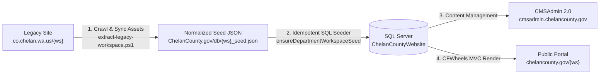

# Chelan County CMSAdmin 2.0 — Document 013
# Legacy Department Workspace Migration Playbook (CFWheels MVC + ColdFusion IIS)

**Document ID:** `013_WORKSPACE_MIGRATION_PLAYBOOK`  
**Version:** 2.0.0  
**Target Stack:** Adobe ColdFusion 2021 + IIS + CFWheels MVC + Microsoft SQL Server (`ChelanCountyWebsite`)  
**Reference Implementations:** `Assessor` (`/assessor`) and `Auditor` (`/auditor`)

---

## 1. Overview & Architecture

This playbook codifies the repeatable, end-to-end engineering process for extracting any legacy department workspace from `https://www.co.chelan.wa.us/{workspace}`, saving its complete content and metadata into the `ChelanCountyWebsite` SQL Server database for management in **CMSAdmin 2.0** (`http://cmsadmin.chelancounty.gov`), and rendering the public department portal at **`http://chelancounty.gov/{workspace}`** (`C:\inetpub\ChelanCounty.gov`) using **CFWheels MVC**.



---

## 2. Database Tables Populated Per Workspace

Every department workspace migration populates the following tables in `ChelanCountyWebsite` (always prepending `SET ANSI_NULLS ON; SET QUOTED_IDENTIFIER ON;` for tables with filtered indexes):

| SQL Server Table | Purpose | Key Workspace Column |
| :--- | :--- | :--- |
| `dbo.cms_workspaces` | Department identity, elected official/director name, title, photo, address, phone, fax, hours, and brand color | `code = '{ws}'` |
| `dbo.pages` | Landing page (`Permalink = 'home'`) and all department subpages (`StatusCode = 'Active'`, `isPublished = 1`, `Visibility = 'Published'`) | `SiteID = '{ws}'` |
| `dbo.page_SubPage` | Attached right-column contextual sidebars (`SidebarIDs` JSON array on `dbo.pages`, `LayoutType = 'Right Sidebar'`) | `SiteID = '{ws}'` |
| `dbo.page_revisions` | Baseline Version 1 snapshot (`version_number = 1`) for the Revision History & Rollback Studio (RCW 42.56 compliance) | `page_id = ContentID` |
| `dbo.page_CtaCard` | Quick Services / Call-to-Action cards rendered on the department landing page (`hasCtaCards = 1`) | `SiteID = '{ws}'` |
| `dbo.page_call_to_actions` | Reusable CTA card library entries in CMSAdmin 2.0 | `siteid = '{ws}'` |
| `dbo.navigation_menus` & `dbo.navigation_menu_items` | Hierarchical left-sidebar department navigation menu (`menu_key = 'side'`) | `siteid = '{ws}'` |
| `dbo.how_do_i_categories` & `dbo.how_do_i_items` | Department-scoped "How Do I..." links | `siteid = '{ws}'` |

---

## 3. Step-by-Step Reusable Migration Process

### Step 1: Extract Legacy Content, Sync Files & Build `{ws}_seed.json`
Run the reusable PowerShell extraction script [extract-legacy-workspace.ps1](file:///c:/inetpub/CMSAdmin2.0/scripts/extract-legacy-workspace.ps1) with `-ExecutionPolicy Bypass`:

```powershell
powershell -ExecutionPolicy Bypass -File "C:\inetpub\CMSAdmin2.0\scripts\extract-legacy-workspace.ps1" `
    -WorkspaceCode "auditor" `
    -DepartmentName "Chelan County Auditor" `
    -OfficialFirstName "Brandt" `
    -OfficialLastName "Cappell" `
    -OfficialTitle "Chelan County Auditor" `
    -OfficialPhoto "/images/logo/auditor.jpg" `
    -Phone "(509) 667-6802" `
    -Fax "(509) 667-6818" `
    -Email "brandt.cappell@co.chelan.wa.us" `
    -Address "350 Orondo Ave" `
    -Address2 "Suite 202" `
    -Hours "Monday - Friday: 9:00 AM - 5:00 PM PST"
```

**What this step automatically handles:**
- Crawls `https://www.co.chelan.wa.us/{ws}`, `/contacts`, `/howdoi`, and all nested `/pages/{slug}` URLs.
- Syncs all local files from `C:\inetpub\Chelan-County\files\{ws}\*` into both `C:\inetpub\CMSAdmin2.0\files\{ws}\` and `C:\inetpub\ChelanCounty.gov\files\{ws}\`, and downloads any newer PDFs/documents from the live site.
- Normalizes HTML content:
  - Rewrites legacy `/pages/{slug}` links to CFWheels `/page/{slug}` routes.
  - Rewrites absolute `https://www.co.chelan.wa.us/files/...` URLs to local `/files/...` paths.
  - Strips leaked ColdFusion comments (`<!--- ... --->`).
  - Replaces legacy obfuscated `String.fromCharCode(...)` mailto links with clean `mailto:` anchors.
  - Upgrades Bootstrap 4 `data-toggle="collapse"` attributes to include Bootstrap 5 `data-bs-toggle="collapse"`.
- Outputs `C:\inetpub\ChelanCounty.gov\db\{ws}_seed.json`.

---

### Step 2: Register CFWheels Routes (`C:\inetpub\ChelanCounty.gov\config\routes.cfm`)
Add the standard department route group in [routes.cfm](file:///c:/inetpub/ChelanCounty.gov/config/routes.cfm) above `.wildcard()`:

```cfscript
// {Department} Department Portal Routes
.get(name="auditor", pattern="/auditor", to="auditor##index")
.get(name="auditorPage", pattern="/auditor/page/[slug]", to="auditor##page")
.get(name="auditorPagesLegacy", pattern="/auditor/pages/[slug]", to="auditor##page")
.get(name="auditorContacts", pattern="/auditor/contacts", to="auditor##contacts")
.get(name="auditorHowDoI", pattern="/auditor/howdoi", to="auditor##howdoi")
.get(name="auditorFile", pattern="/auditor/file", to="auditor##file")
```

---

### Step 3: Create the CFWheels Controller & Views
1. **Controller (`C:\inetpub\ChelanCounty.gov\app\controllers\{Dept}.cfc`):**
   - Copy [Auditor.cfc](file:///c:/inetpub/ChelanCounty.gov/app/controllers/Auditor.cfc) as the template.
   - In `prepare{Dept}Workspace()`, call `ensureDepartmentWorkspaceSeed(siteid="{ws}", force=(StructKeyExists(params, "reseed") && params.reseed == "1"))`, `site = getWorkspace("{ws}")`, and `nav = getNavigation("{ws}")`.
   - Use CFWheels `model("Page").findOne(...)` in `index()` and `page()`, and `getHowDoIBySite("{ws}")` in `howdoi()`.
2. **Views (`C:\inetpub\ChelanCounty.gov\app\views\{ws}\`):**
   - Copy `index.cfm`, `page.cfm`, `contacts.cfm`, and `howdoi.cfm` from `app/views/auditor/`.
   - All views compose the shared department partials in `app/views/shared/`:
     - `_dept-hero.cfm` (Department banner + breadcrumb + phone CTA)
     - `_dept-notifications.cfm` (Active emergency/department alerts)
     - `_dept-official.cfm` (Elected official / director card)
     - `_dept-nav.cfm` (Dynamic left-sidebar menu from `dbo.navigation_menus`)
     - `_dept-contact.cfm` (Address, phone, fax, and office hours card)
     - `_dept-cta-cards.cfm` (Quick Services cards from `dbo.page_CtaCard`)
     - `_dept-overview.cfm` (Main page body with shortcode rendering)
     - `_dept-folder-explorer.cfm` (Attached Folder Explorer widget)
     - `_dept-right-sidebar.cfm` (Attached right-column sidebars from `dbo.page_SubPage`)
     - `_dept-meta.cfm` (Last Updated timestamp & back-to-top footer)

---

### Step 4: Reload & Seed via ColdFusion IIS
Trigger the CFWheels reload and database seeder over HTTP on IIS:

```powershell
Invoke-WebRequest -Uri "http://chelancounty.gov/{ws}?reload=true&password=chelancms&reseed=1" -UseBasicParsing
```

Verify HTTP 200 across:
- `http://chelancounty.gov/{ws}` (Landing page + CTA cards + overview)
- `http://chelancounty.gov/{ws}/page/{slug}` (Subpages, including right-sidebar pages)
- `http://chelancounty.gov/{ws}/contacts` (Office Details, Hours & Division Directory)
- `http://chelancounty.gov/{ws}/howdoi` (Department How Do I directory)
- `http://cmsadmin.chelancounty.gov/pages?ws={ws}` (CMSAdmin 2.0 Content Manager)
