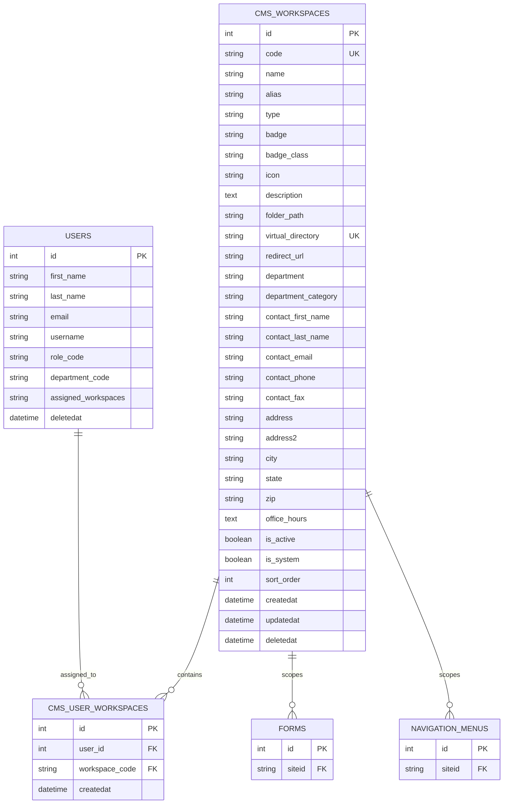

# Chelan County CMS Admin 2.0 — Workspace Architecture

This document records the Workspace module's schema, application surfaces, and
current behavior for maintainers. It covers the canonical department and portal
records used to scope content, user access, and filesystem layout across the
site.

## Overview

The Workspace module manages the CMS's multi-tenant operating model. Each
workspace represents a county department, unified county-wide view, or public
portal, and it carries the metadata used to scope access, routing, media storage,
and staff visibility.

The system uses a small set of canonical workspace records that are seeded into
`cms_workspaces` and then consumed by the admin UI, user-role logic, and various
content modules such as forms, navigation, and media.

The module has four main responsibilities:

1. Maintain the canonical list of workspaces and their metadata.
2. Enforce admin-only creation and editing for system-owned workspace records.
3. Provision each workspace's filesystem directory and virtual folder mapping.
4. Associate users with workspace access via `cms_user_workspaces`.

## Current behavior and boundaries

- The system expects a canonical set of workspace records for county departments,
  public portals, and the global scope. `ensureMasterWorkspacesTablePopulated()`
  creates missing records if the database has fewer than the expected entries.
- The admin index page (`GET /workspaces`) is restricted to system admins. It
  loads the workspace master list, joins user assignments, and summarizes counts,
  folders, and disk status.
- New workspaces are created through `POST /workspaces/create` and auto-create a
  dedicated file tree under `C:\inetpub\CMSAdmin2.0\files\<workspace-code>` with
  `media/` and `documents/` subfolders.
- A workspace is identified by `code` and `virtual_directory`, and both are
  enforced as unique values in the SQL schema.
- User access is computed from `cms_user_workspaces` plus fallback department-based
  logic when no explicit mapping exists.
- The module owns metadata used by other apps, including `folder_path`,
  `redirect_url`, `department_category`, and `type` (`global`, `dept`, or `site`).
- The workspace object is also used as a scoping key for site-level content and
  media storage, not just a display list.

## Relational schema



### Tables

| Table | Purpose |
| --- | --- |
| `cms_workspaces` | Canonical workspace catalog for departments, global scope, and public portals. |
| `cms_user_workspaces` | User-to-workspace access mapping used for explicit staff scoping. |

The SQL Server schema is in `config/sql/schema-workspaces.sql`, and the
migration is `app/migrator/migrations/20261004170000_create_workspaces_table.cfc`.
The seed logic for the default county workspaces is in
`app/global/functions.cfm`.

## Workspace data shape

The workspace payload used during creation and editing is conceptually shaped
like this:

```json
{
  "code": "assessors",
  "name": "Assessor - Property & Parcels",
  "type": "dept",
  "virtual_directory": "assessors",
  "folder_path": "files/assessors",
  "department": "Assessor",
  "department_category": "Finance and Records",
  "redirect_url": "https://www.chelancounty.gov/assessor",
  "contact": {
    "first_name": "Deanna",
    "last_name": "Walter",
    "email": "assessor@chelancounty.gov",
    "phone": "509-667-6365",
    "fax": "509-667-6664",
    "address": "350 Orondo Ave",
    "city": "Wenatchee",
    "state": "WA",
    "zip": "98801"
  }
}
```

The actual database stores most of this as flat columns rather than nested JSON,
with the exception of logical helper payloads created in controller code before
insertion.

## Application surfaces

| Surface | Responsibility |
| --- | --- |
| `app/controllers/Workspaces.cfc` | Admin-only workspace directory, create form, validation, save, and edit flow. |
| `app/models/Workspace.cfc` | ORM metadata for `cms_workspaces`, including associations and validation rules. |
| `app/models/UserWorkspace.cfc` | Link model for `cms_user_workspaces` and the user mapping relationship. |
| `app/views/workspaces/index.cfm` | Directory dashboard with filter tabs, KPI cards, and per-workspace details. |
| `app/views/workspaces/new.cfm` | Create-workspace form with type selector, routing settings, and contact metadata. |
| `app/views/workspaces/edit.cfm` | Edit existing workspace values and update metadata. |
| `app/global/functions.cfm` | Seed logic for the system default workspaces and related workspace helpers. |

## Routes

| Method | Path | Action |
| --- | --- | --- |
| `GET` | `/workspaces` | Workspace directory dashboard |
| `GET` | `/workspaces/new` | Create new workspace form |
| `POST` | `/workspaces/create` | Insert workspace and create disk folders |
| `GET` | `/workspaces/edit?id=<id>` | Edit a saved workspace |
| `POST` | `/workspaces/update` | Persist workspace changes |

These routes are configured in `config/routes.cfm` and are explicitly labeled as
admin-only.

## Domain model and behavior

The workspace record is the identity anchor for site-scoped content across the
application.

- `code` acts as the canonical workspace identifier and is used as the stable
  key in the database and across filters.
- `type` distinguishes:
  - `global` — county-wide master view
  - `dept` — county department or division
  - `site` — public-facing portal or web property
- `virtual_directory` is used as the folder alias and must be unique. It is the
  human- and URL-facing key for the workspace's showing path.
- `folder_path` maps to the physical folder used for media and documents stored
  under `files/<workspace-code>`.
- `redirect_url` provides an optional outbound redirect target for site records.
- `department_category` and `department` are used for filtering and admin grouping.
- `is_active`, `is_system`, and `sort_order` are used to manage visibility and
  ordering in the admin directory.

## User assignment rules

Staff membership is derived in the controller from a combination of explicit user
workspace assignments and fallback department-based logic.

When the controller loads the workspace directory it:

1. Runs a query for `cms_users`.
2. Loads all rows from `cms_user_workspaces` into a mapping keyed by `user_id`.
3. Builds a workspace list for each user.
4. Falls back to `department_code` or `global` if no explicit mapping exists.
5. Flags the workspace as containing a user if the user matches the workspace ID
   or is scoped to the global workspace.

This means the workspace directory can represent both direct assignment and
implicit membership without requiring full application-level RBAC tables.

## Security and access

- Workspace administration is restricted to the `admin` role via
  `getCurrentActiveRole()` checks in the controller.
- The UI is not exposed to non-admins, and they are redirected back to the main
  dashboard if they attempt to access the module.
- All workspace creation and update actions require an authenticated admin flow
  and a valid CSRF token through the standard Wheels authentication helper.
- Data is not globally open: workspace visibility and access are scoped by the
  workspace model and by explicit user-to-workspace mappings.

## Seeded workspace catalog

The canonical workspace list includes a county-wide global workspace and a set of
municipal department and portal records, for example:

- `global` — All Workspaces
- `assessor` — Assessor - Property & Parcels
- `auditor` — Auditor - Elections & Records
- `human-resources` — HRM - Human Resources
- `communications` — PIO - Public Information
- `community-development` — Community Development
- `public-works` — Public Works
- `admin` — County Administration
- `site-main` — chelancounty.gov
- `site-parks` — parks.chelancounty.gov

This list is intentionally seeded and deliberately narrow, making the workspace
model predictable and enabling a stable system of site scoping.

## Implementation notes

A few patterns matter for maintainers working in this module:

- The controller sometimes uses direct SQL rather than the model layer for admin
  dashboards and data assembly. This is intentional for SQL Server-backed
  reporting and staff scope aggregation.
- Directory creation is done on the filesystem during workspace creation. This
  is part of the bootstrap contract for media and document storage.
- The `Workspace` model enforces a strict type set and uniqueness rules for code
  and virtual directory values, which helps prevent workspace collisions.
- The dimension is not just presentational; `forms.siteid` and
  `navigation_menus.siteid` reference the workspace scope, so workspace records
  are part of the app's content partitioning model.

## Summary

The Workspace module is the application’s identity and access boundary for the
county’s multi-site CMS model. It binds department metadata, user scoping,
site-level content, and local filesystem provisioning into one compact record set.
The result is a single place to govern how staff access the platform and how
content is routed and stored across the public-facing county ecosystem.
